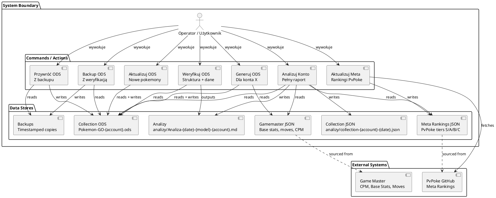
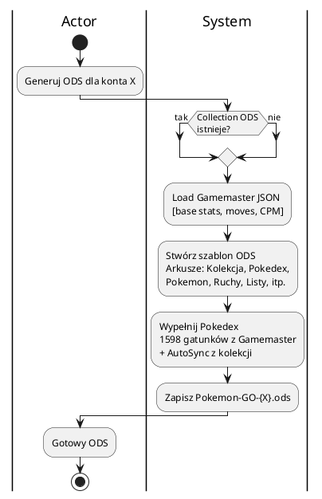
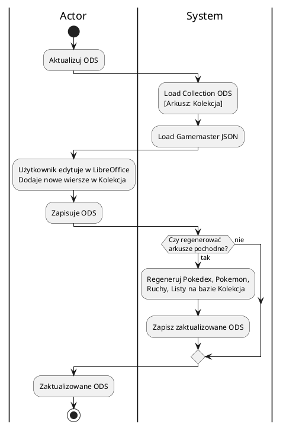
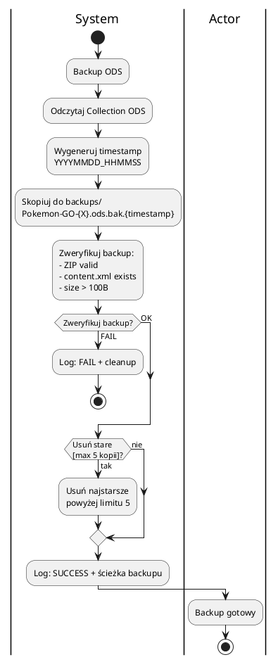
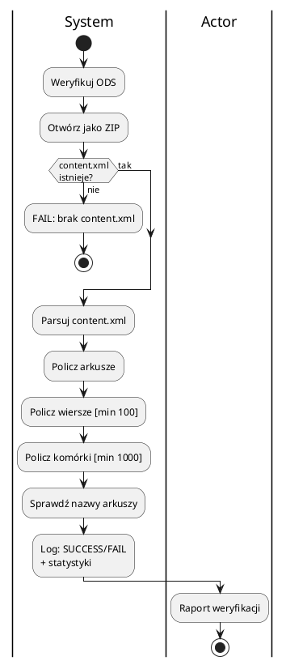
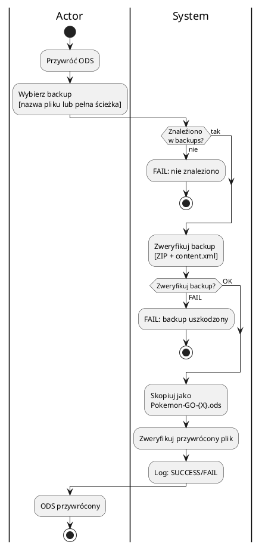
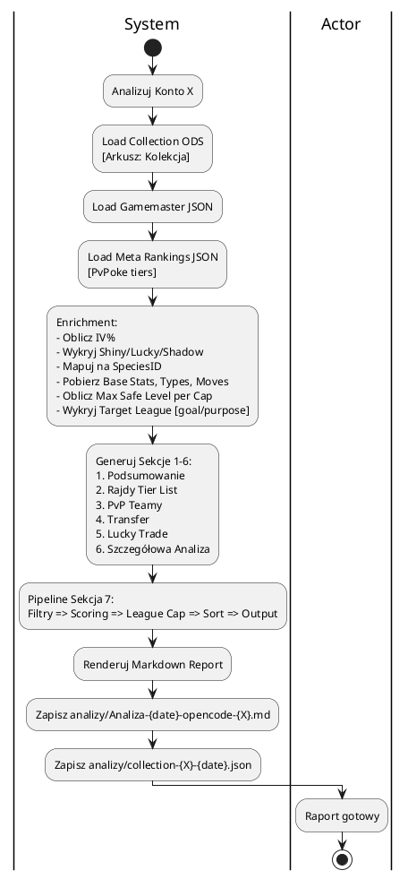
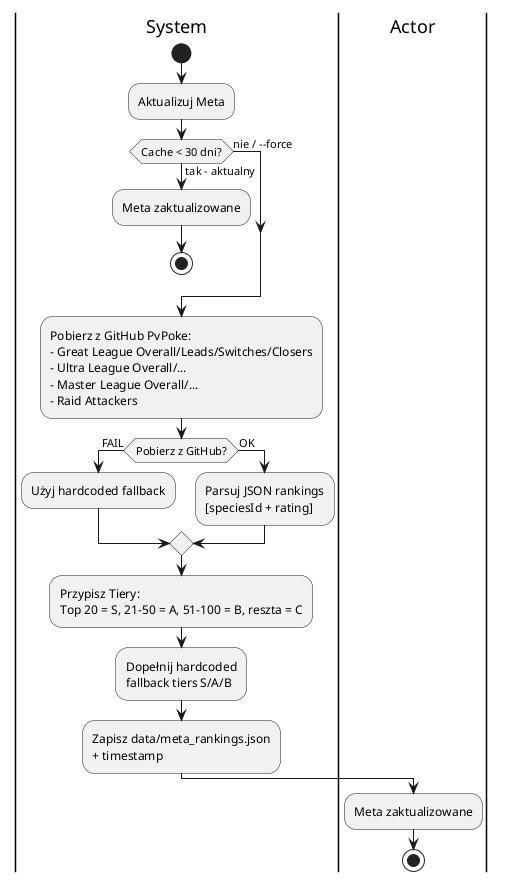

# Akcje Użytkownika - Context Diagram

> **Cel:** Przedstawić wszystkie akcje jakie może wykonać Aktor (Operator) na systemie, bez wiązania do konkretnych plików/skryptów.
> System jest agnostyczny względem implementacji (Python, Go, Rust, itp.).

---

## Context Overview

---

## Akcje - Szczegółowe Widoki

### 1. Generuj ODS (Create New Collection)

### 2. Aktualizuj ODS (Add New Pokemon to Existing)

### 3. Backup ODS (z weryfikacją)

### 4. Weryfikuj ODS

### 5. Przywróć ODS z Backupu

### 6. Analizuj Konto (Pełny Raport)

### 7. Aktualizuj Meta Rankings (PvPoke)

---

## Podsumowanie Encji i Relacji

| Encja | Źródło | Opis |
|-------|--------|------|
| **Collection** | ODS (Arkusz: Kolekcja) | Wiersze = pokemony użytkownika (UID, IV, CP, moves, tags, purpose, goal) |
| **Gamemaster** | JSON (PvPoke) | Base stats, moves, CPM table, shadow/mega eligible, typing |
| **MetaRankings** | JSON (cached PvPoke) | Tiery S/A/B/C per speciesId |
| **Backup** | Timestamped ODS copy | Max 5 kopii, weryfikowane |
| **Report** | Markdown | 7-sekcja analiza + ranking rozwoju |
| **CollectionJSON** | JSON snapshot | Debug / dalsze przetwarzanie |
