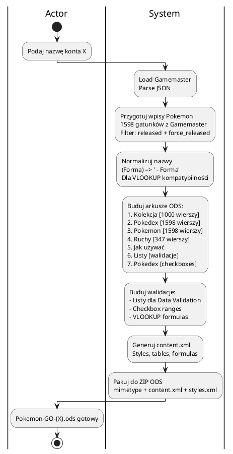
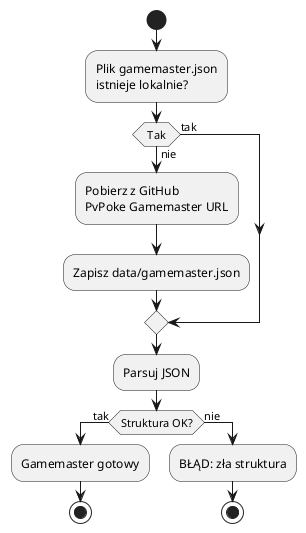
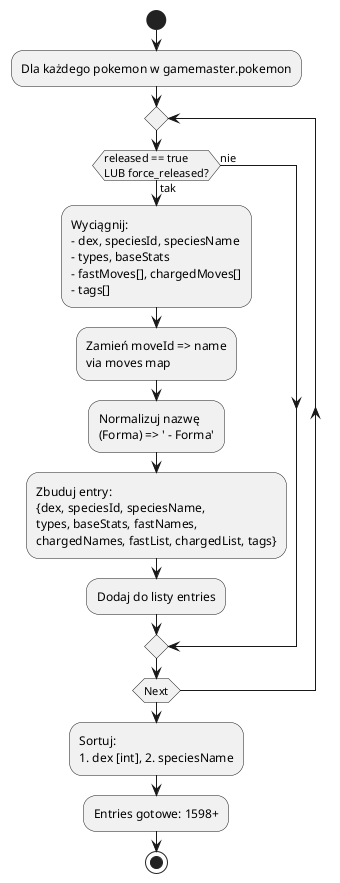
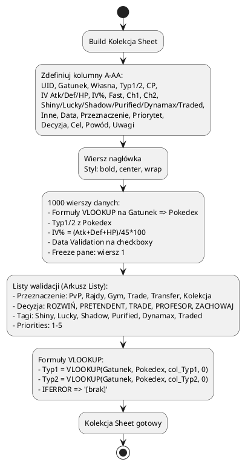
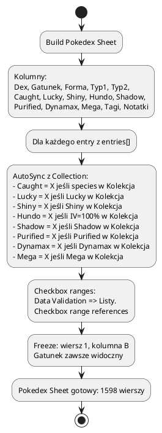
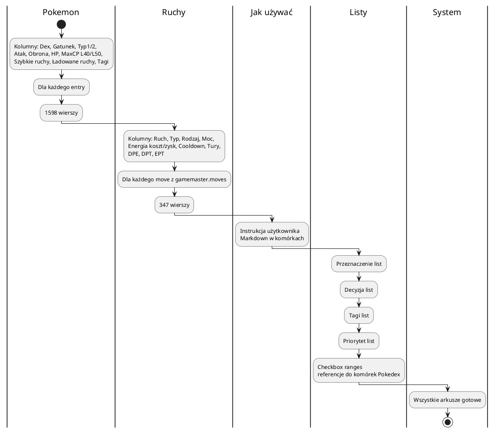
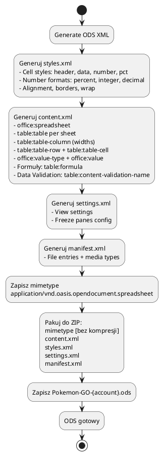
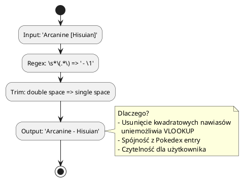
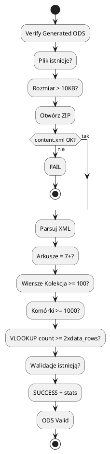

# Generowanie ODS - Pipeline

> **Cel:** Pełny pipeline tworzenia pliku `Pokemon-GO-{account}.ods` gotowego do pracy w LibreOffice.
> Proces jest idempotentny - może być uruchomiony wielokrotnie, nadpisując plik.

---

## Pipeline Overview

---

## Szczegóły Kroków

### 1. Load Gamemaster

### 2. Prepare Pokemon Entries

### 3. Build Sheets - Arkusz Kolekcja (Główny)

### 4. Build Sheets - Arkusz Pokedex (1598 gatunków)

### 5. Build Sheets - Pokemon, Ruchy, Listy

### 6. Generate content.xml + Package ODS

---

## Normalizacja Nazw - Kluczowa Logika

---

## Walidacja Wygenerowanego ODS

---

## Parametry Wejściowe / Wyjściowe

| Parametr | Typ | Opis |
|----------|-----|------|
| `account` | string | Nazwa konta (np. `Adzik`, `Shizaya09`) |
| `gamemaster_path` | path | Opcjonalny - override ścieżki gamemaster.json |
| `output_path` | path | Opcjonalny - override ścieżki wyjściowej |
| `force` | bool | Wymuś regenerację nawet jeśli plik istnieje |

---

## Zależności Zewnętrzne

| Źródło | Format | Częstotliwość aktualizacji |
|--------|--------|---------------------------|
| PvPoke Gamemaster | JSON | Co wydanie Game Mastera (co ~2 tygodnie) |
| PvPoke Rankings | JSON (cached) | Co miesiąc / --force |

---

## Błędy i Obsługa

| Błąd | Reakcja |
|------|---------|
| Brak Gamemaster JSON | Pobierz z GitHub |
| Brak `released` flag | Użyj `force_released` set |
| Błąd XML generation | Log + FAIL |
| Zła struktura ODS | Log + FAIL (weryfikacja wykryje) |
