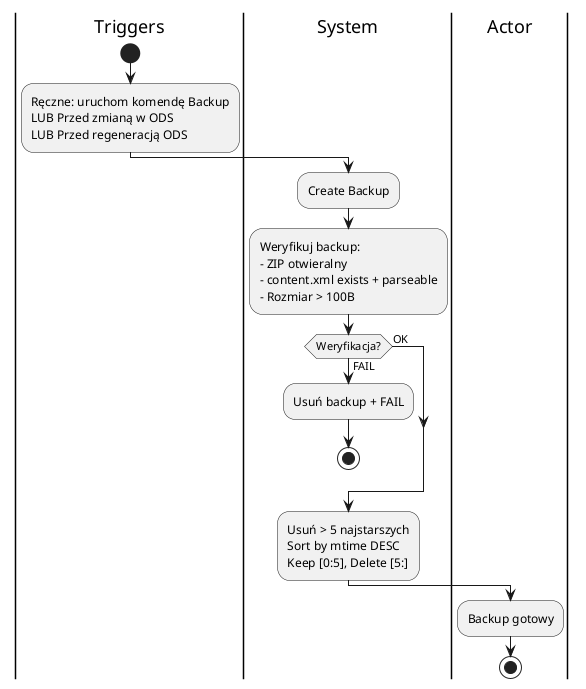
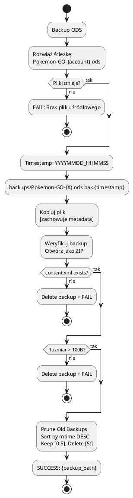
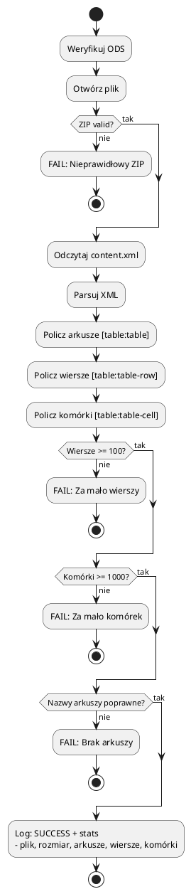
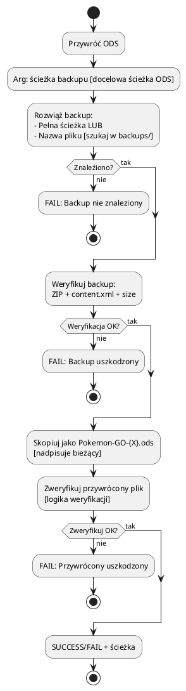
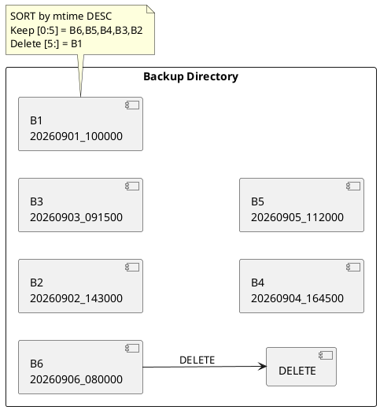
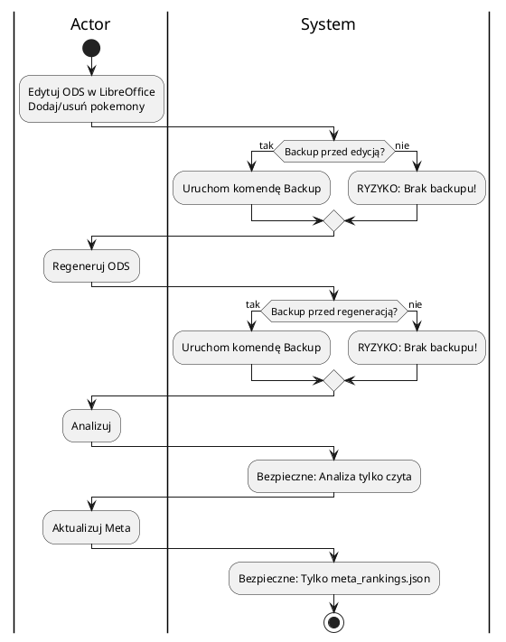
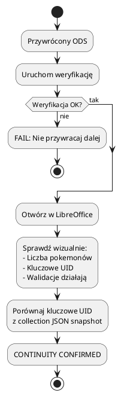
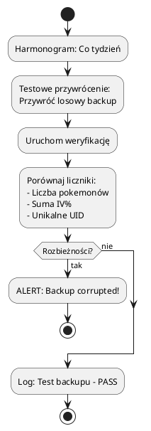

# Backup i Weryfikacja ODS

> **Cel:** Strategia backupu, weryfikacji integralności i odzyskiwania danych.
> Zasada: **Ostatni backup zawsze musi być grywalny** - to Twoja polisa ubezpieczeniowa.

---

## Strategia Backupu

---

## Proces Tworzenia Backupu

---

## Weryfikacja ODS

---

## Przywracanie z Backupu

---

## Polityka Retencji

| Parametr | Wartość |
|----------|---------|
| Max kopii | 5 per konto |
| Sortowanie | Według mtime (modification time) DESC |
| Usuwane | Wszystkie poza 5 najnowszymi |
| Nazewnictwo | `Pokemon-GO-{account}.ods.bak.YYYYMMDD_HHMMSS` |

---

## Workflow Bezpieczeństwa (Kiedy robić backup?)

> **ZASADA ZŁOTA:** **Backup PRZED KAŻDĄ ZMIANĄ W ODS**. Analiza i aktualizacja meta są read-only - nie wymagają backupu.

---

## Scenariusze Awaryjne

| Scenariusz | Rozwiązanie |
|------------|-----------|
| ODS uszkodzony po edycji w LO | Przywróć najnowszy backup |
| Regeneracja ODS z błędnymi danymi | Przywróć backup sprzed regeneracji |
| Przypadkowe usunięcie ODS | Przywróć najnowszy backup |
| Błąd w regeneracji | Backup nie dotknięty → przywróć |
| Chcesz cofnąć do wersji z X dni temu | Przywróć konkretny backup z datą |

---

## Weryfikacja Ciągłości (Po przywróceniu)

---

## Metryki Backupu

| Metryka | Wartość docelowa |
|---------|-----------------|
| Czas backupu | < 2 sekundy |
| Czas weryfikacji | < 1 sekunda |
| Czas przywracania | < 3 sekundy |
| Maksymalny rozmiar backupu | ~500 KB (zależny od ODS) |
| Prędkość prune | < 0.1 sekundy |

---

## Testowanie Backupu (Chaos Engineering)

> **Cel:** Upewnić się, że backupy są **grywalne** - nie tylko "istnieją".
