# Przywracanie ODS z Backupu

> **Cel:** Procedury odzyskiwania danych z backupów - od prostego cofnięcia po disaster recovery.

---

## Scenariusze Przywracania

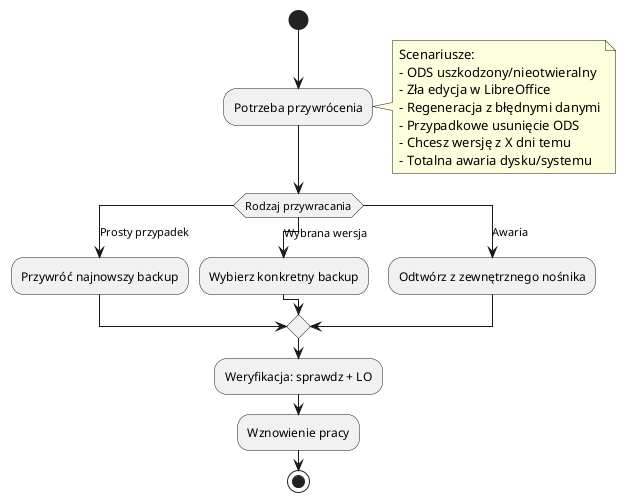

---

## Komenda Przywracania

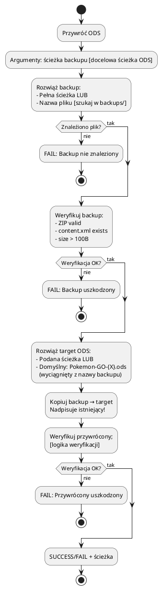

---

## Interaktywne Wybieranie Backupu

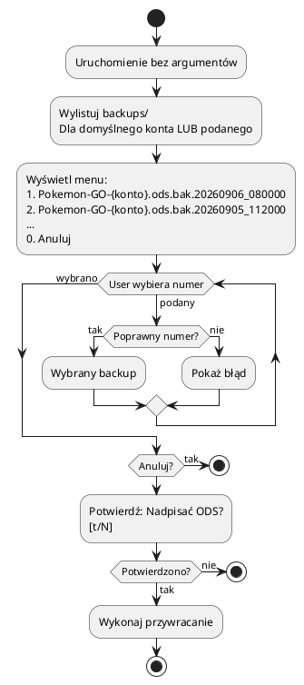

---

## Procedury Specyficzne

### 1. Cofnięcie złej edycji w LibreOffice

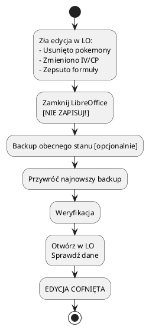

> **Wskazówka:** Jeśli nie zapisałeś w LO - plik ODS na dysku jest nienaruszony. Backup potrzebny tylko jeśli już zapisałeś.

### 2. Regeneracja ODS z błędnymi danymi

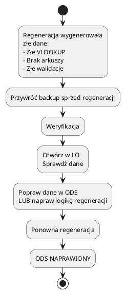

### 3. Przywrócenie do wersji z X dni temu

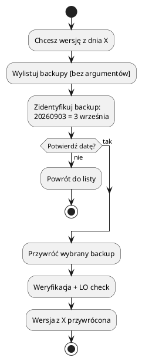

### 4. Disaster Recovery (Totalna awaria)

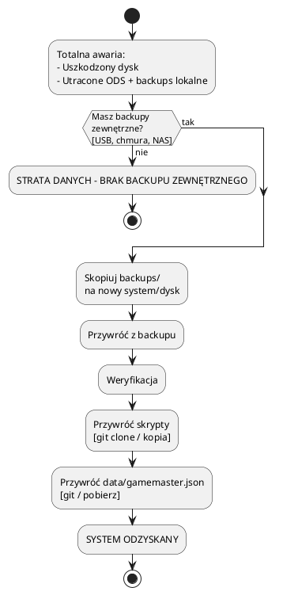

> **KRITYCZNE:** Backupy muszą być **zewnętrzne** (USB, chmura, NAS). Lokalne backups/ na tym samym dysku nie chronią przed awarią dysku.

---

## Weryfikacja Po Przywróceniu (Checklista)

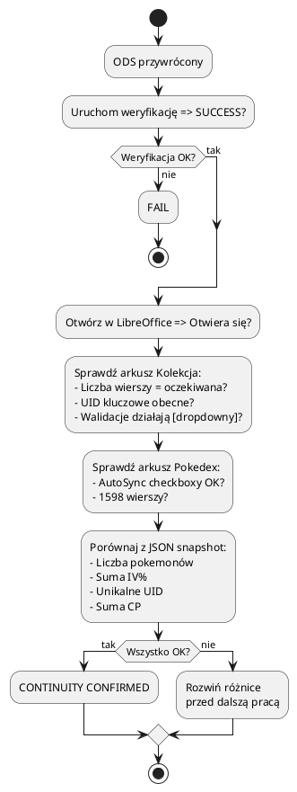

> **Zasada:** Jeśli jakakolwiek metryka się nie zgadza → **STOP**, nie pracuj dalej, rozwiąż różnicę.

---

## Automatyzacja Weryfikacji (Post-Restore Hook)

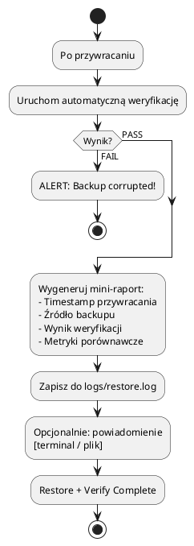

---

## Logowanie Przywracania

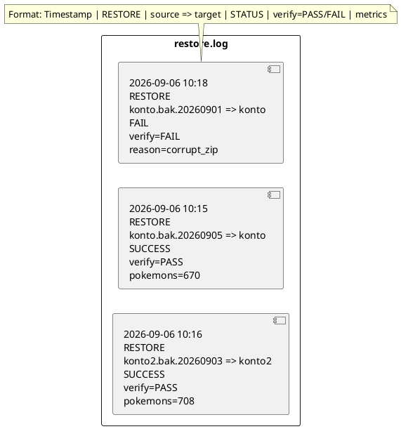

---

## Integracja z Backup Policy

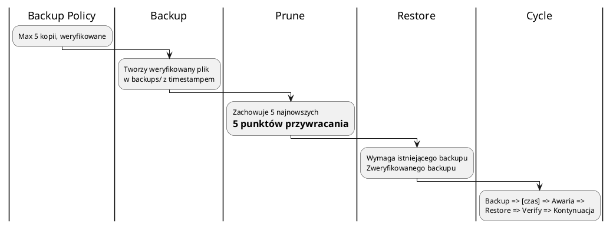

> **Zasada:** System backup-restore jest **domknięty** - backup tworzy plik, który restore potrafi odtworzyć, a verify potwierdza.
