# Analiza Kolekcji — Pipeline Przetwarzania


## Co robimy?

Analiza kolekcji Pokemon GO to automatyczny pipeline, który przechodzi cztery etapy:

1. **Ładowanie danych wejściowych** — otwieranie plików, parsowanie, wczytywanie do pamięci
2. **Obróbka danych** — obliczanie pól, normalizacja, mapowanie, wzbogacanie każdego Pokemon o obliczone atrybuty
3. **Analiza danych** — filtrowanie, scoring, klasyfikacja, generowanie 7 sekcji raportu
4. **Prezentacja wyników** — formatowanie Markdown, zapis raportu i snapshotu kolekcji

### Dla kogo?

Pipeline jest wielokontowy — każdy gracz ma swój plik ODS (np. `Pokemon-GO-{konto}.ods`). Wspólny gamemaster i rankingi meta.

### Wejście / Wyjście

| Wejście | Wyjście |
|---------|---------|
| `Pokemon-GO-{account}.ods` — arkusz Kolekcja | `analizy/Analiza-{date}-opencode-{account}.md` — raport 7 sekcji |
| `data/gamemaster.json` — base stats, ruchy, CPM | `analizy/collection-{account}-{date}.json` — snapshot kolekcji |
| `data/meta_rankings.json` — tier listy S/A/B/C | |

---

## Kroki analizy

```
1. ŁADOWANIE DANYCH WEJŚCIOWYCH
   ├── Otwórz ODS (arkusz Kolekcja)
   ├── Wczytaj gamemaster.json
   └── Wczytaj meta_rankings.json

2. OBRÓBKA DANYCH
   ├── Oblicz IV% = (Atk+Def+HP)/45*100
   ├── Wykryj flagi: Shiny, Lucky, Shadow, Purified, Dynamax, Traded
   ├── Normalizuj gatunek → SpeciesID
   ├── Pobierz Base Stats, Types, Moves z gamemaster
   ├── Oblicz Max Safe Level per liga (GL/UL/ML)
   └── Wykryj Target League (goal > purpose > tags > AUTO)

3. ANALIZA DANYCH
   ├── Sekcja 1: Ogólne podsumowanie
   ├── Sekcja 2: Zestawy do Rajdów
   ├── Sekcja 3: Zestawy do PvP
   ├── Sekcja 4: Kandydaci do Transferu
   ├── Sekcja 5: Poszukiwani do Lucky Trades
   ├── Sekcja 6: Szczegółowa analiza (ocena 1-10)
   └── Sekcja 7: Ranking Rozwoju (scoring 0-100)

4. PREZENTACJA WYNIKÓW
   ├── Zapisz raport → analizy/Analiza-{date}-{account}.md
   └── Zapisz snapshot → analizy/collection-{account}-{date}.json
```

---

## Przegląd architektury

> Kompletny pipeline — od danych źródłowych po gotowy raport.

### PlantUML

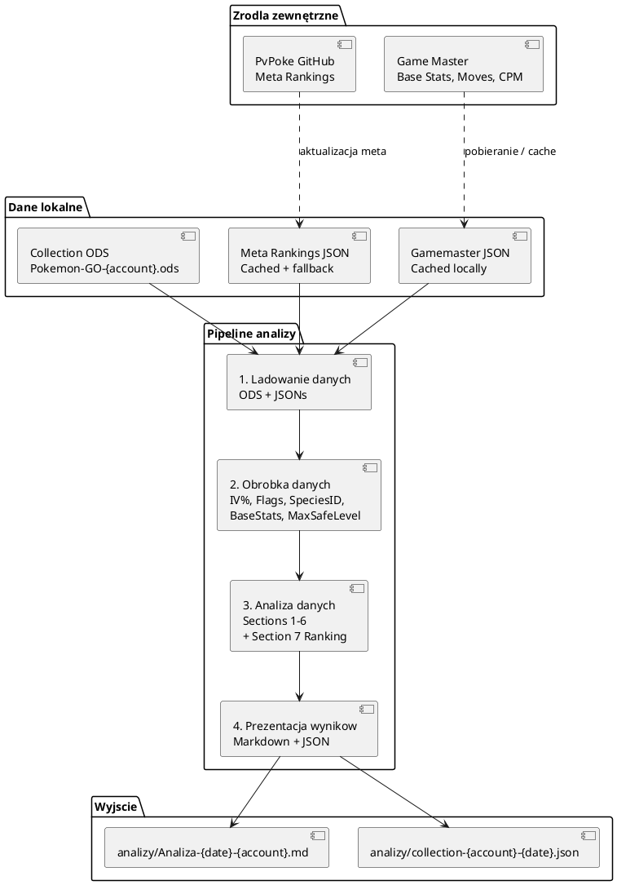


---

## Szczegóły kolejnych kroków

> Poniżej będziemy rozbijać każdy krok na osobne diagramy.

### 1. Ładowanie danych wejściowych

#### Co ładujemy?

Pipeline potrzebuje trzech niezależnych źródeł danych:

| # | Źródło | Co zawiera | Dlaczego |
|---|--------|-----------|----------|
| A | **Kolekcja Pokemon** | Lista Pokemon gracza (CP, IV, ruchy, tagi) | Dane wejściowe do analizy |
| B | **Gamemaster** | Base stats, typy, ruchy, CPM table, shadow-eligible | Kontekst gry — mapowanie na mechaniki |
| C | **Meta Rankings** | Tier listy S/A/B/C per liga + raid attackers | Co jest meta — do scoringu i rekomendacji |

#### Abstrakcja źródeł

Każde źródło ma **interfejs API** — implementacja zależy od konfiguracji:

```
┌─────────────────────────────────────────────────┐
│              Collection Loader                   │
│  API: load(account) → List[PokemonRaw]          │
├─────────────────────────────────────────────────┤
│  Implementacja A: Import z pliku ODS            │
│  Implementacja B: Odczyt z bazy danych (API)    │
└─────────────────────────────────────────────────┘

┌─────────────────────────────────────────────────┐
│              Gamemaster Loader                   │
│  API: load() → GamemasterData                   │
├─────────────────────────────────────────────────┤
│  Implementacja A: Import z pliku JSON           │
│  Implementacja B: Download ze strony + cache    │
│  Implementacja C: Odczyt z bazy danych (API)    │
└─────────────────────────────────────────────────┘

┌─────────────────────────────────────────────────┐
│              Meta Rankings Loader                │
│  API: load() → MetaRankingsData                 │
├─────────────────────────────────────────────────┤
│  Implementacja A: Import z pliku JSON           │
│  Implementacja B: Download ze strony + cache    │
│  Implementacja C: Odczyt z bazy danych (API)    │
└─────────────────────────────────────────────────┘
```

#### Kontrakty (co importujemy i w jakim formacie)

> Format: OpenAPI 3.0 Schema — silnie typowany, niezależny od języka, generuje kod w wielu językach.

##### PokemonRaw — surowy Pokemon z kolekcji

```yaml
PokemonRaw:
  type: object
  required: [uid, species, cp, iv_a, iv_d, iv_h]
  properties:
    uid:
      type: string
      example: "P-00123"
      description: Unikalny identyfikator Pokemon
    species:
      type: string
      example: "Garchomp"
      description: Nazwa gatunku (znormalizowana)
    nick:
      type: string
      example: "Domownik"
      description: Przydzielona nazwa
    cp:
      type: integer
      minimum: 10
      example: 3500
      description: Combat Power
    iv_a:
      type: integer
      minimum: 0
      maximum: 15
      example: 15
      description: Attack IV
    iv_d:
      type: integer
      minimum: 0
      maximum: 15
      example: 14
      description: Defense IV
    iv_h:
      type: integer
      minimum: 0
      maximum: 15
      example: 15
      description: HP IV
    fast:
      type: string
      example: "Dragon Tail"
      description: Szybki ruch
    ch1:
      type: string
      example: "Sand Tomb"
      description: Charged move 1
    ch2:
      type: string
      example: "Earth Power"
      description: Charged move 2
    purpose:
      type: string
      enum: [PvP, Rajdy, Gym, Trade, Transfer, Kolekcja]
      example: "PvP"
      description: Przeznaczenie
    tags:
      type: string
      example: "Shiny, Lucky"
      description: Tagi oddzielone przecinkami
    date:
      type: string
      format: date
      example: "2024-01-15"
      description: Data wpisu
    priority:
      type: integer
      minimum: 1
      maximum: 5
      example: 3
      description: Priorytet
    decision:
      type: string
      enum: [ROZWIN, PRETENDENT, TRADE, PROFESOR, ZACHOWAJ]
      example: "ROZWIN"
      description: Decyzja
    goal:
      type: string
      example: "Great League"
      description: Docelowa liga
    reason:
      type: string
      example: "Ma IV 93%"
      description: Powód decyzji
    notes:
      type: string
      example: "Lapany w Berlinie"
      description: Notatki
```

##### GamemasterData — dane gry

```yaml
GamemasterData:
  type: object
  required: [pokemon, moves, shadowIds, cpmTable, nameToSpecies]
  properties:
    pokemon:
      type: object
      description: "Mapa: speciesId → PokemonEntry"
      additionalProperties:
        $ref: "#/components/schemas/PokemonEntry"
    moves:
      type: object
      description: "Mapa: moveId → MoveEntry"
      additionalProperties:
        $ref: "#/components/schemas/MoveEntry"
    shadowIds:
      type: array
      items:
        type: string
      description: "Lista speciesId shadow-eligible"
    cpmTable:
      type: array
      items:
        $ref: "#/components/schemas/CpmEntry"
      description: "CPM per level (1.0 - 50.0)"
    nameToSpecies:
      type: object
      description: "Mapa: znormalizowana nazwa → speciesId"
      additionalProperties:
        type: string

PokemonEntry:
  type: object
  required: [speciesId, speciesName, types, baseStats]
  properties:
    speciesId:
      type: string
      example: "garchomp"
    speciesName:
      type: string
      example: "Garchomp"
    types:
      type: array
      items:
        type: string
      minItems: 1
      maxItems: 2
      example: ["dragon", "ground"]
      description: "Typy Pokemon (1 lub 2)"
    baseStats:
      $ref: "#/components/schemas/BaseStats"
    fastMoves:
      type: array
      items:
        type: string
      example: ["Dragon Tail", "Mud Shot"]
    chargedMoves:
      type: array
      items:
        type: string
      example: ["Sand Tomb", "Earth Power", "Outrage"]
    tags:
      type: array
      items:
        type: string
      example: ["starter"]

BaseStats:
  type: object
  required: [atk, def, hp]
  properties:
    atk:
      type: integer
      example: 261
    def:
      type: integer
      example: 193
    hp:
      type: integer
      example: 227

MoveEntry:
  type: object
  required: [moveId, name, type, category]
  properties:
    moveId:
      type: string
      example: "dragon_tail"
    name:
      type: string
      example: "Dragon Tail"
    type:
      type: string
      example: "dragon"
    category:
      type: string
      enum: [fast, charged]
    power:
      type: integer
      example: 110
    energyGain:
      type: integer
      example: 10
    cooldown:
      type: number
      format: float
      example: 0.7

CpmEntry:
  type: object
  required: [level, cpm]
  properties:
    level:
      type: number
      format: float
      example: 40.0
    cpm:
      type: number
      format: float
      example: 0.7903
```

##### MetaRankingsData — rankingi meta

```yaml
MetaRankingsData:
  type: object
  required: [greatLeague, ultraLeague, masterLeague, raidAttackers, tierS, tierA, tierB]
  properties:
    greatLeague:
      type: array
      items:
        type: string
      description: "Kolejność: top → bottom"
    ultraLeague:
      type: array
      items:
        type: string
    masterLeague:
      type: array
      items:
        type: string
    raidAttackers:
      type: array
      items:
        type: string
    tierS:
      type: array
      items:
        type: string
      description: "S-tier (zawsze obecny — hardcoded fallback)"
    tierA:
      type: array
      items:
        type: string
      description: "A-tier (zawsze obecny — hardcoded fallback)"
    tierB:
      type: array
      items:
        type: string
      description: "B-tier (zawsze obecny — hardcoded fallback)"
```

#### Diagram — Ładowanie danych

##### PlantUML

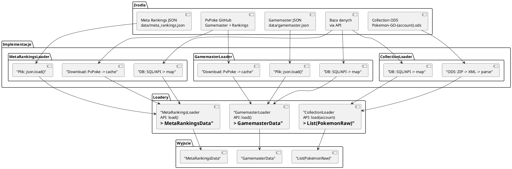

##

### 2. Obróbka danych

#### Co się dzieje?

Dane wejściowe z Kroku 1 nie mogą trafić bezpośrednio do Analizy (Krok 3). `PokemonRaw` nie ma obliczonych pól (IV%, flagi, gatunek w formacie gamemastera, base stats, meta tier...).

Krok 2 **tworzy obiekt Pokemon** — wzbogaconą wersję `PokemonRaw` gotową do analizy.

#### Co wychodzi z Kroku 2?

Jeden obiekt na każdego Pokemon. To on jest argumentem wejściowym Kroków 3.

##### Kontrakt: Pokemon (obiekt wzbogacony)

> Rozszerza `PokemonRaw` o 15 pól obliczonych.

```yaml
Pokemon:
  allOf:
    - $ref: "#/components/schemas/PokemonRaw"
    - type: object
      description: "Pola obliczone podczas Obrobki (Krok 2)"
      properties:

        # --- Obliczone z IV ---
        iv_pct:
          type: number
          format: float
          minimum: 0
          maximum: 100
          example: 93.3
          description: "IV% = (Atk+Def+HP)/45*100"

        is_hundo:
          type: boolean
          example: false
          description: "true jeśli iv_pct = 100.0"

        # --- Flagi z tags ---
        is_lucky:
          type: boolean
        is_shiny:
          type: boolean
        is_shadow:
          type: boolean
        is_purified:
          type: boolean
        is_dynamax:
          type: boolean
        is_traded:
          type: boolean

        # --- Mapowanie na gamemaster ---
        species_id:
          type: string
          example: "garchomp"
          description: "speciesId z gamemaster (znormalizowane)"

        base_stats:
          $ref: "#/components/schemas/BaseStats"

        types:
          type: array
          items:
            type: string
          minItems: 1
          maxItems: 2
          example: ["dragon", "ground"]
          description: "Typy Pokemon (1 lub 2). Bez pustych wpisów."

        fast_moves:
          type: array
          items:
            type: string
          description: "Dostępne szybkie ruchy z gamemaster"

        charged_moves:
          type: array
          items:
            type: string
          description: "Dostępne charged ruchy z gamemaster"

        # --- Meta ---
        meta_tier:
          type: string
          enum: [S, A, B, C]
          example: "S"
          description: "Klasyfikacja meta (S/A/B/C)"

        # --- Rodzina ---
        family_id:
          type: string
          example: "FAMILY_BULBASAUR"
          description: "ID rodziny ewolucyjnej (candy dzielone)"
        family_evos:
          type: array
          items:
            type: string
          example: ["ivysaur", "venusaur"]
          description: "Lista ewolucji w rodzinie (do czego mogę ewoluować)"
        family_parent:
          type: string
          nullable: true
          example: null
          description: "Rodzic (z czego mogę się wyewoluować). null = base form"

        # --- Scoring ---
        dev_score:
          type: number
          format: float
          minimum: 0
          maximum: 100
          example: 82.5
          description: "Score rozwoju (0-100)"
```

#### Pola z `PokemonRaw` (odziedziczone)

| Pole | Typ | Opis |
|------|-----|------|
| `uid` | string | Unikalny ID |
| `species` | string | Nazwa gatunku |
| `nick` | string | Przydzielona nazwa |
| `cp` | int | Combat Power |
| `iv_a`, `iv_d`, `iv_h` | int | IV Attack/Defense/HP |
| `fast` | string | Aktualny szybki ruch |
| `ch1`, `ch2` | string | Aktualne charged ruchy |
| `purpose` | string | Przeznaczenie |
| `tags` | string | Tagi |
| `date` | string | Data wpisu |
| `priority` | int | Priorytet 1-5 |
| `decision` | string | Decyzja |
| `goal` | string | Docelowa liga |
| `reason` | string | Powód |
| `notes` | string | Notatki |

#### Pola obliczone (dodane w Kroku 2)

| Pole | Typ | Zależy od | Obliczenie |
|------|-----|-----------|------------|
| `iv_pct` | float | iv_a, iv_d, iv_h | (A+D+H)/45*100 |
| `is_hundo` | bool | iv_pct | iv_pct == 100.0 |
| `is_lucky` | bool | tags | "Lucky" in tags |
| `is_shiny` | bool | tags | "Shiny" in tags |
| `is_shadow` | bool | tags | "Shadow" in tags |
| `is_purified` | bool | tags | "Purified" in tags |
| `is_dynamax` | bool | tags | "Dynamax" in tags |
| `is_traded` | bool | tags | "Traded" in tags |
| `species_id` | string | species + gamemaster | lookup w name_to_species |
| `base_stats` | dict | species_id + gamemaster | lookup w species_by_id |
| `types` | list | species_id + gamemaster | lookup w species_by_id |
| `fast_moves` | list | species_id + gamemaster | lookup w species_by_id |
| `charged_moves` | list | species_id + gamemaster | lookup w species_by_id |
| `meta_tier` | string | species_id + is_shadow | classify_meta_tier() |
| `family_id` | string | species_id + gamemaster | family.id z gamemaster |
| `family_evos` | list | species_id + gamemaster | family.evolutions z gamemaster |
| `family_parent` | string? | species_id + gamemaster | family.parent z gamemaster (null = base) |
| `dev_score` | float | wszystkie | score_development_candidate() |

#### Kolejność obliczeń

```
PokemonRaw
  │
  ├──→ iv_pct = (iv_a + iv_d + iv_h) / 45 * 100
  │       └──→ is_hundo = (iv_pct == 100.0)
  │
  ├──→ is_lucky, is_shiny, is_shadow, is_purified, is_dynamax, is_traded
  │       (z parsowania tags)
  │
  ├──→ species_id = name_to_species[species]
  │       ├──→ base_stats    = species_by_id[species_id].baseStats
  │       ├──→ types         = species_by_id[species_id].types
  │       ├──→ fast_moves    = species_by_id[species_id].fastMoves
  │       ├──→ charged_moves = species_by_id[species_id].chargedMoves
  │       ├──→ family_id     = species_by_id[species_id].family.id
  │       ├──→ family_evos   = species_by_id[species_id].family.evolutions
  │       ├──→ family_parent = species_by_id[species_id].family.parent
  │       │
  │       └──→ meta_tier = classify_meta_tier(species_id, is_shadow)
  │
  └──→ dev_score = score(podsumowanie wszystkich pól)
          │
          ▼
        Pokemon (gotowy do Krok 3)
```

> **Uwaga:** `dev_score` zależy od WSZYSTKICH pól — stąd musi być obliczony na samym końcu.

#### Diagram — Obrobka danych

##### PlantUML

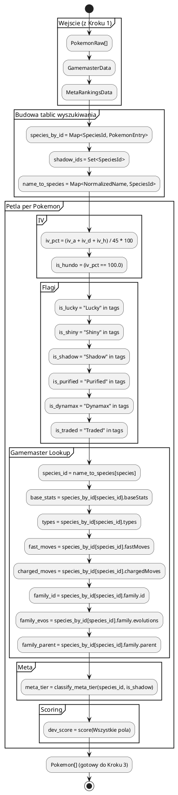

##

### 3. Analiza danych

#### Podejście: Multi-pass

Dla każdej sekcji (1-7) iterujemy przez CAŁĄ kolekcję osobno. Każda sekcja ma własną logikę filtrów, sortowania i formatowania.

```
Pokemon[] (z Kroku 2)
    │
    ├──→ Sekcja 1: Ogólne podsumowanie     (pass 1)
    ├──→ Sekcja 2: Zestawy do Rajdów       (pass 2)
    ├──→ Sekcja 3: Zestawy do PvP           (pass 3)
    ├──→ Sekcja 4: Kandydaci do Transferu   (pass 4)
    ├──→ Sekcja 5: Poszukiwani do Lucky     (pass 5)
    ├──→ Sekcja 6: Szczegółowa analiza      (pass 6)
    └──→ Sekcja 7: Ranking Rozwoju          (pass 7)
            │
            ▼
        Raport (do Kroku 4)
```

#### Dlaczego multi-pass?

| Zaleta | Opis |
|--------|------|
| **Izolacja sekcji** | Każda sekcja ma własne filtry — nie wpływa na inne |
| **Testowalność** | Każdą sekcję mogę przetestować osobno |
| **Czytelność** | Łatwo zrozumieć co robi dana sekcja |
| **Wydajność** | Kolekcja ok. 10000 Pokemon × 7 sekcji = akceptowalne |

#### Dane wejściowe / wyjściowe

| Wejście | Wyjście per sekcja |
|---------|-------------------|
| `Pokemon[]` (10000 obiektów) | Sekcja 1: statystyki (count, TOP 10 listy) |
| | Sekcja 2: tier listy S/A/B/C |
| | Sekcja 3: drużyny GL/UL/ML |
| | Sekcja 4: transfer / zachowaj |
| | Sekcja 5: lucky trade wishlist |
| | Sekcja 6: oceny 1-10 per kategoria |
| | Sekcja 7: ranking 0-100 |

#### Diagram — Multi-pass Algorithm

##### PlantUML

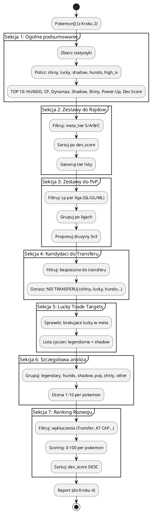

##

#### Sekcje — podgląd

> Szczegóły każdej sekcji opisujemy poniżej.

| # | Sekcja | Kluczowe filtry | Sortowanie | Output |
|---|--------|----------------|------------|--------|
| 1 | Ogólne podsumowanie | Brak (count all) | N/A | Statystyki + TOP 10 listy |
| 2 | Zestawy do Rajdów | Typ bossa → super-effective | CP DESC, IV% DESC | Raid by Type + Multipurpose + Tier Listy |
| 3 | Zestawy do PvP | CP range per liga + meta_tier S/A/B | dev_score DESC | Druzyny 3v3 (GL/UL/ML) + Coverage |
| 4 | Transfer | 4 gates: shiny/lucky/shadow/hundo → tier → purpose | CP DESC | Safe list (30) + NIE TRANSFERUJ rules |
| 5 | Lucky Trade | `gamemaster.tags[]` + `meta_rankings.raid_attackers` | Lucky set + normalize speciesId | Priority 1 (Legendary∩MetaS) + Priority 2 (Shadow∩MetaS/A) + strategy |
| 6 | Szczegółowa analiza | 6 podkategorii (Legendary, HUNDO, Shadow, PvP, Shiny, Inne) | dev_score DESC (lub CP dla HUNDO) | Ocena 1-10 + rekomendacja per podkategoria |
| 7 | Ranking Rozwoju | dev_score (7 komponentów, 0-100) | dev_score DESC | Ranking z numeracją (osobny .puml) |

---

#### Sekcja 1: Ogólne podsumowanie

##### Co robimy?

Zbieramy statystyki kolekcji i generujemy TOP 10 listy. Zero filtrowania — liczymy wszystko.

##### Co zbieramy?

| Kategoria | Pola | Opis |
|-----------|------|------|
| **Podsumowanie** | `total` | Łączna ilość Pokemon |
| **Rozkład tagów** | `shiny_count`, `lucky_count`, `shadow_count`, `purified_count`, `dynamax_count`, `traded_count` | Ilość + % z całości |
| **Rozkład IV** | `hundo_count`, `high_iv_count` (≥90%) | Ilość + % |
| **Rozkład tierów** | `tier_s_count`, `tier_a_count`, `tier_b_count`, `tier_c_count` | Ile w każdym tierze |
| **Rozkład celów** | `purpose_rajdy`, `purpose_pvp`, `purpose_transfer`, `purpose_kolekcja` | Ile per przeznaczenie |
| **Rodziny** | `family_count` | Ile unikalnych rodzin ewolucyjnych |

##### TOP 10 listy (tabela)

Wszystkie TOP 10 są prezentowane w formacie tabel Markdown.

| Lista | Filtr | Sortowanie | Kolumny |
|-------|-------|------------|---------|
| **TOP 10 HUNDO** | `iv_pct == 100.0` | CP DESC | #, Pokemon, CP, Lucky, Purpose |
| **TOP 10 CP** | Brak | CP DESC | #, Pokemon, CP, IV%, Lucky, Purpose |
| **TOP 10 Dynamax** | `is_dynamax == true` | CP DESC | #, Pokemon, CP, IV%, Tier |
| **TOP 10 Shadow** | `is_shadow == true` | dev_score DESC | #, Pokemon, CP, IV%, Tier, Score |
| **TOP 10 Shiny** | `is_shiny == true` | dev_score DESC | #, Pokemon, CP, IV%, Tier, Lucky |
| **TOP 10 Power-Up** | `iv_pct ≥ 90%, cp < 2500`, exclude max CP, exclude PvP at GL cap | dev_score DESC | #, Pokemon, CP, IV%, Tier, Score |
| **TOP 10 Dev Score** | Brak | dev_score DESC | #, Pokemon, CP, IV%, Tier, Score |

**Power-Up wykluczenia:**
- Pokemon na max CP (`cp >= max_cp`) — nie ma sensu podciągać
- Pokemon z Purpose=PvP na GL cap (`cp >= 1450`) — podciąganie wyrzuca z GL

**Meta vs Collection** — tabela porównawcza Raid Attackers TOP 20 z kolekcją. Kolumny: #, Pokemon, Tier, Masz?, Ile, Najl. IV, Lucky, Score. Na końcu: Meta Coverage %.

##### Diagram — Sekcja 1


---

#### Sekcja 2: Zestawy do Rajdów

##### Co robimy?

Rekomendujemy Pokemon do Rajdów na podstawie **typu bossa** (nie tagu purpose). Każdy boss ma typ ataku — rekomendujemy Pokemon z typami super-effective.

##### Dlaczego nie filtrujemy po purpose?

Pokemon oznaczony jako "PvP" (np. UL, max CP 3800) może być **świetnym raid attackerem** jeśli jego typy są super-effective przeciwko bossowi. Filtr po purpose odrzuca takeCases.

##### Algorytm

```
1. Dla każdego typu bossa (Dark, Psychic, Fire...):
   - Określ typy super-effective
     (np. Dark boss → Fighting, Bug, Fairy)
   - Dla każdego Pokemon z kolekcji (CP >= 1000):
     - Oblicz ATK/DEF ratio: (BaseAtk + IVAtk) * CPM_L40 * ShadowBonus / BossDEF
     - Oblicz DPS z bieżącymi ruchami (STAB + Effectiveness)
     - Znajdź optymalne ruchy (maksymalny DPS)
   - Sortuj: DPS DESC → TOP N per typ bossa

2. Uniwersalny ranking:
   - Wszystkie Pokemon z CP >= 1000
   - Effectiveness = 1.0 (neutralne)
   - Sortuj: DPS DESC → TOP 10

3. Kolumny w raporcie:
   - ATK: efektywny statystyk ataku Pokemon
   - DPS: obrażenia na sekundę (z ruchami bieżącymi)
   - Optimal: DPS z optymalnymi ruchami
   - MoveDPS: surowy DPS ruchów (bez statystyk Pokemon)
```

##### Typy bossów → Super-effective

| Typ bossa | Super-effective |
|-----------|----------------|
| Dark | Fighting, Bug, Fairy |
| Psychic | Dark, Bug, Ghost |
| Fire | Water, Ground, Rock |
| Water | Electric, Grass |
| Grass | Fire, Ice, Poison, Flying, Bug |
| Electric | Ground |
| Ground | Water, Grass, Ice |
| Ice | Fire, Fighting, Rock, Steel |
| Fighting | Flying, Psychic, Fairy |
| Poison | Ground, Psychic |
| Ground | Water, Grass, Ice |
| Flying | Electric, Ice, Rock |
| Psychic | Dark, Bug, Ghost |
| Bug | Fire, Flying, Rock |
| Rock | Water, Grass, Fighting, Ground, Steel |
| Ghost | Dark, Ghost |
| Dragon | Ice, Dragon, Fairy |
| Steel | Fire, Fighting, Ground |
| Fairy | Poison, Steel |

##### Dane wejściowe / wyjściowe

| Wejście | Wyjście |
|---------|---------|
| `Pokemon[]` (z Kroku 2) | `raid_by_type: Map<TypBossa, RaidResult[]>` — TOP N per typ |
| `GamemasterData` | Each RaidResult contains: |
| | - `Pokemon` — dane Pokemon |
| | - `DPS` — obrażenia na sekundę (z ATK/DEF ratio) |
| | - `OptimalDPS` — DPS z optymalnymi ruchami |
| | - `MoveDPSFast` — surowy DPS szybkiego ruchu |
| | - `MoveDPSCharged` — surowy DPS charged ruchu |
| | `universal: RaidResult[]` — TOP 10 uniwersalnych |

##### Diagram — Sekcja 2

###### PlantUML

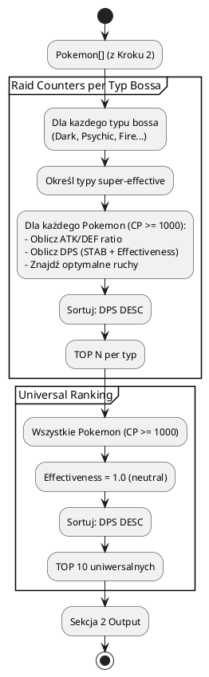

###

---

#### Sekcja 3: Zestawy do PvP

##### Co robimy?

Dla każdej ligi (GL/UL/ML) filtrujemy Pokemon po CP, sortujemy po meta tier i generujemy propozycje drużyn 3v3.

##### Konfiguracja lig

> Standardowe ligi definiowane przez CP limit. Specjalne pucharki z `gamemaster.formats`.

| Liga | CP Limit | Cup (gamemaster) | Meta Source |
|------|----------|------------------|-------------|
| Great League | 1500 | — (default) | `great_league_overall` |
| Ultra League | 2500 | — (default) | `ultra_league_overall` |
| Master League | Brak limitu | — (default) | `master_league_overall` |
| Mega Master League | 10000 | `mega` | `mega` |
| Master Premier | 10000 | `premier` | `premiermaster` |
| *+ specjalne pucharki* | *1500* | *z gamemaster* | *per cup* |

> **Źródło:** `gamemaster.formats[]` — każdy format ma `cup`, `cp`, `meta`.

##### Algorytm

```
1. Wczytaj konfiguracje lig z gamemaster.formats[]
   (lub użyj defaultowych: GL/UL/ML)

2. ROWNOLEGLE per liga (fork):
   - Pobierz CP limit z format.cp
   - Pobierz meta source z format.meta
   - FILTRUJ: cp per zakres ligi
   - FILTRUJ: meta_tier S/A/B (z ligowych rankingów)
   - SORTUJ: dev_score DESC
   - GRUPUJ per styl (balanced/aggressive/defensive)
   - GENERUJ druzyny 3v3 (lead/switch/closer)
   - ANALIZA coverage (typy pokryte/brakujące)

3. POLĄCZ wyniki z workerow
```

##### Dane wejściowe / wyjściowe

| Wejście | Wyjście per liga |
|---------|-----------------|
| `Pokemon[]` (z Kroku 2) | `candidates: Pokemon[]` — fitują do CP cap |
| `MetaRankingsData` | `teams: Team[]` — propozycje 3v3 |
| | `coverage: CoverageAnalysis` — typy pokryte/brakujące |

##### Struktura Team

```yaml
Team:
  type: object
  properties:
    name:
      type: string
      example: "Team A — Ballanced"
    style:
      type: string
      enum: [balanced, aggressive, defensive]
    members:
      type: array
      minItems: 3
      maxItems: 3
      items:
        $ref: "#/components/schemas/TeamMember"
    coverage:
      type: array
      items:
        type: string
      description: "Typy pokryte przez drużynę"
    weaknesses:
      type: array
      items:
        type: string
      description: "Typy słabe (brak counterów)"

TeamMember:
  type: object
  properties:
    role:
      type: string
      enum: [lead, switch, closer]
    pokemon:
      $ref: "#/components/schemas/Pokemon"
    moveset:
      type: string
      example: "Dragon Breath / Outrage / Close Combat"
```

##### Diagram — Sekcja 3

###### PlantUML

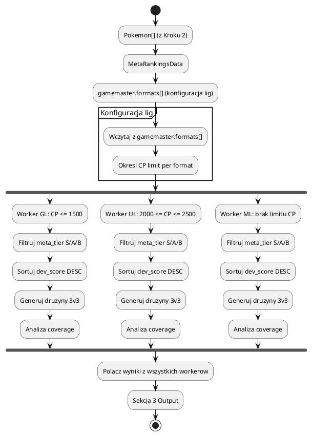

###

---

#### Sekcja 4: Kandydaci do Transferu

##### Co robimy?

Określamy które Pokemon można bezpiecznie transferować. Filtry są **rodzinowe** — porównujemy Pokemon z tej samej rodziny ewolucyjnej.

##### Filtry atomowe (kolejność ma znaczenie)

> **Dla każdego Pokemon:** pobierz `family_members` = wszystkie Pokemon z tej samej rodziny (family_id).

###### Filtr 1: Shiny (kontekst rodzinowy)

```
Jeden shiny w rodzinie?
  → ZACHOWAJ (jedyny)

Jest lepszy shiny w rodzinie?
  → TEN = TRADE (gorszy shiny)
  → JEŚLI już ma flagę "traded" → nie da się poprawić → TRANSFER OK

Brak shiny w rodzinie?
  → Idź do Filtru 2
```

| Scenariusz | Wynik |
|------------|-------|
| 1 shiny w rodzinie | **ZACHOWAJ** |
| 2+ shiny, ten jest lepszy | **ZACHOWAJ** |
| 2+ shiny, ten jest gorszy | **TRADE** |
| 2+ shiny, ten jest gorszy + already traded | **TRANSFER OK** |

###### Filtr 2: IV% + CP (porównanie w rodzinie)

> **Nie traktujemy IV% i CP rozłącznie.** Koszt inwestycji zależy od obu.

```
Pojedynczy Pokemon w rodzinie?
  → ZACHOWAJ (brak alternatywy, Szukaj Lucky Trade)

Jest HUNDO (100% IV)?
  → ZACHOWAJ (priorytet: wyższy level)
  → Kilka HUNDO? Zachowaj WSZYSTKIE (nie powtarzają się)

Porównaj z najlepszym w rodzinie:
  - Różnica CP > 50%? (koszt inwestycji za duży)
    → TEN = TRADE / TRANSFER (za mały stosunek korzyści do kosztów)
  - Różnica CP ≤ 50%?
    → Porównaj IV%: wyższy IV% → lepszy
    → Jeśli ten ma wyższy IV% → ZACHOWAJ (starszy może być na trade)
    → Jeśli ten ma niższy IV% → TRADE
```

| Scenariusz | Wynik |
|------------|-------|
| 1 Pokemon w rodzinie | **ZACHOWAJ** (szukaj Lucky Trade) |
| HUNDO (jeden) | **ZACHOWAJ** |
| Kilka HUNDO | **ZACHOWAJ WSZYSTKIE** |
| 2+ Pokemon, CP diff > 50% | **TRANSFER/TRADE** (ten z niższym CP) |
| 2+ Pokemon, CP diff ≤ 50%, ten ma lepszy IV% | **ZACHOWAJ** |
| 2+ Pokemon, CP diff ≤ 50%, ten ma gorszy IV% | **TRADE** |

###### Filtr 3: Meta + Ilość (max_keep_per_species)

```
meta_tier in (S, A+)?
  → Ile mamy takich Pokemon? (species_count)
  → count < max_keep (default: 10)?
    → ZACHOWAJ
  → count >= max_keep?
    → Porównaj z innymi w tej samej specji
    → Najsłabszy (najniższy IV% + CP) → TRANSFER
```

| Scenariusz | Wynik |
|------------|-------|
| Meta S/A+, count < 10 | **ZACHOWAJ** |
| Meta S/A+, count >= 10, ten najsłabszy | **TRANSFER** |
| Meta S/A+, count >= 10, ten nie jest najsłabszy | **ZACHOWAJ** |

###### Filtr 4: Purpose (ostrzeżenie, nie hard-keep)

```
purpose = "kolekcja"?
  → Jeśli PRZED filtrem 4 był kandydatem do transferu:
    → OSTRZEŻENIE: "Element oznaczony do kolekcji - usuwać w ostateczności"
    → Nie blokuj transferu, ale dodaj warning
```

> **Purpose "kolekcja" to NIE jest twardy filtr.** To sugestia z ostrzeżeniem.

##### Status transferu

Każdy Pokemon otrzymuje status:

```yaml
TransferStatus:
  type: string
  enum:
    - SAFE        # Bezpieczny do transferu
    - KEEP        # Zatrzymaj (shiny/hundo/meta/ilosc)
    - TRADE       # Oznacz do trade (gorszy w rodzinie)
    - SOFT_KEEP   # Oznaczony jako kolekcja - usuwać w ostateczności

TransferResult:
  type: object
  properties:
    pokemon:
      $ref: "#/components/schemas/Pokemon"
    status:
      $ref: "#/components/schemas/TransferStatus"
    reason:
      type: string
      example: "Gorszy shiny w rodzinie (lepszy: P-00456)"
    warning:
      type: string
      nullable: true
      example: "Element oznaczony do kolekcji - usuwać w ostateczności"
```

##### Algorytm

```
1. Zbuduj indeks rodzin:
   family_groups = group_by(collection, family_id)

2. Dla każdego Pokemon:
   - Pobierz family_members z family_groups
   - Uruchom Filtr 1 (Shiny) → status lub next
   - Uruchom Filtr 2 (IV%+CP) → status lub next
   - Uruchom Filtr 3 (Meta+Ilość) → status lub next
   - Uruchom Filtr 4 (Purpose) → dodaj warning
   - Zapisz TransferResult

3. Sortuj: SAFE (CP DESC) → TRADE → KEEP

4. Output:
   - SAFE: TOP 30 + "... i N więcej"
   - TRADE: lista do wymiany
   - KEEP: lista zachoconych
   - Ostrzeżenia: SOFT_KEEP
```

##### Diagram — Sekcja 4

###### PlantUML

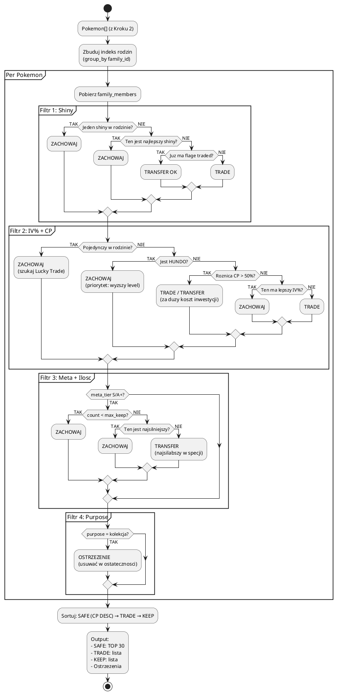

###

---

#### Sekcja 5: Poszukiwani do statusu Lucky

##### Co robimy?

Generujemy listę Pokemon, których warto szukać w Lucky Trades. Listy **dynamiczne** — generowane z `gamemaster.json` + `meta_rankings.json`.

##### Źródła danych (zamiast hardcoded)

| List | Źródło | Jak wygenerować |
|------|--------|-----------------|
| **Priority 1: Legendary/Mythical** | `gamemaster.json` — `tags[]` contains `"legendary"` or `"mythical"` | Filter po tagach |
| **Meta tier S/A** | `meta_rankings.json` — `rankings.raid_attackers` (top 10 = S, 10-19 = A) | Pozycja na liście |
| **Priority 1 output** | ∩ (Legendary/Mythical) ∩ (Meta S-tier) | Przecięcie zbiorów |
| **Priority 2: Shadow Meta** | `gamemaster.json` — `tags[]` contains `"shadoweligible"` + meta S/A tier | Filter po tagach + meta |
| **Lucky check** | `collection` — `is_lucky == true` | Zbiór Lucky species |

##### Normalizacja speciesId

> **Problem:** `meta_rankings.json` używa `stunfisk_galarian`, `gamemaster.json` używa `galarian_stunfisk`.

```
normalizuj(speciesId):
  # Zamień konwencję meta_rankings na gamemaster
  # "stunfisk_galarian" → "galarian_stunfisk"
  # "giratina_origin" → "giratina_origin" (bez zmian)
  parts = split(speciesId, "_")
  if parts[0] in ("galarian", "alolan", "hisuian", "paldean"):
    return "_".join(parts[1:] + [parts[0]])
  return speciesId
```

##### Algorytm

```
1. Zbuduj indeksy:
   lucky_set = {p.species for p in collection if p.is_lucky}
   meta_rankings = załaduj meta_rankings.json
   meta_s = meta_rankings.raid_attackers[:10]   # top 10
   meta_a = meta_rankings.raid_attackers[10:20] # 10-19

2. Priorytet 1: Legendary/Mythical + Meta S-tier
   candidates_1 = [
     p for p in gamemaster
     if ("legendary" in p.tags OR "mythical" in p.tags)
     AND normalize(p.speciesId) in meta_s
   ]
   Dla każdego:
     - Sprawdź: species in lucky_set?
     - Output: ✅ MASZ Lucky / ❌ BRAK Lucky

3. Priorytet 2: Shadow-eligible + Meta S/A-tier
   candidates_2 = [
     p for p in gamemaster
     if "shadoweligible" in p.tags
     AND normalize(p.speciesId) in (meta_s ∪ meta_a)
   ]
   Dla każdego:
     - Sprawdź: masz Shadow? (collection)
     - Sprawdź: masz Lucky? (lucky_set)
     - Output: Polacz statusy

4. Strategia (hardcoded — uniwersalne porady):
   1. Handel to jedyny sposob na uzyskanie Lucky
   2. Gwarantowany Lucky Trade przeznaczaj na legendy
   3. Nie handluj HUNDO
   4. Im starszy Pokemon, tym wyzszy szansa na Lucky
   5. Candy XL z handlu zalezy od odleglosci łapania
```

##### Struktury danych

```yaml
LuckyCandidate:
  type: object
  properties:
    species:
      type: string
    speciesId:
      type: string
    reason:
      type: string
      example: "Dragon Ascent, Master League domination"
    tags:
      type: array
      items:
        type: string
    meta_tier:
      type: string
      enum: [S, A]
    have_lucky:
      type: boolean
    have_shadow:
      type: boolean
      nullable: true
      description: "Tylko dla Priority 2"
```

##### Diagram — Sekcja 5

###### PlantUML

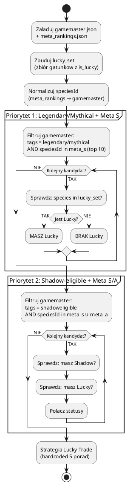

###

---

#### Sekcja 6: Szczegółowa analiza — Ocena 1-10

##### Co robimy?

Szczegółowa analiza kolekcji w 6 podkategoriach. Każda sortuje po `dev_score` i generuje rekomendacje.

##### Podkategorie

###### 1. Legendary / Mythical

```
Filtr: meta_tier in (S, A) AND base_stats_sum >= 600
Sort: dev_score DESC
Ocena: min(10, max(1, dev_score / 10))
Rekomendacja: Power-Up do L50 (IV >= 90) / Czekaj na lepszy
```

| Pola | Opis |
|------|------|
| Species | Nazwa |
| Ocena | 1-10 (z dev_score) |
| IV | Procent |
| Lucky | Tak/Nie |
| CP | Combat Power |
| Zastosowanie | Rajdy/ML (default) |
| Rekomendacja | Power-Up / Czekaj |

###### 2. HUNDO (100% IV)

```
Filtr: is_hundo
Sort: CP DESC
Rekomendacja: ZAWSZE "MAX OUT (L50)"
```

| Pola | Opis |
|------|------|
| Species | Nazwa |
| CP | Combat Power |
| Lucky | Tak/Nie |
| Shadow | Tak/Nie |
| Rekomendacja | MAX OUT (L50) |

###### 3. Shadow (Frustration → Return)

```
Filtr: is_shadow
Sort: dev_score DESC
Frustration check: base = species_id.replace("_shadow", "")
                   base in shadow_ids (508 gatunków)
Rekomendacja: Oczyszcz i rozwiń (frustration_removable AND IV >= 80)
              Zachowaj na Event (w innym przypadku)
```

| Pola | Opis |
|------|------|
| Species | Nazwa |
| IV | Procent |
| Lucky | Tak/Nie |
| Frustration removable | Tak/Nie |
| Rekomendacja | Oczyszcz / Zachowaj na Event |

###### 4. PvP Relevant

```
Filtr: purpose in (pvp, great league, ultra league, master league)
       OR meta_tier in (S, A)
Sort: dev_score DESC
Limit: TOP 30
Rekomendacja: 2nd Move + Power-Up (IV >= 85) / Zachowaj
```

| Pola | Opis |
|------|------|
| Species | Nazwa |
| IV | Procent |
| CP | Combat Power |
| Lucky | Tak/Nie |
| Moves | fast/ch1/ch2 |
| Rekomendacja | 2nd Move + Power-Up / Zachowaj |

###### 5. Shiny

```
Filtr: is_shiny
Sort: dev_score DESC
Meta annotation: ⭐ META (jeśli meta_tier S/A)
Rekomendacja: Rozwiń jeśli meta / Kolekcja
```

| Pola | Opis |
|------|------|
| Species | Nazwa |
| IV | Procent |
| Lucky | Tak/Nie |
| Meta | ⭐ META (jeśli S/A) |
| Rekomendacja | Rozwiń / Kolekcja |

###### 6. Inne (Dynamax, Purified, Traded)

```
Filtr: is_dynamax
       OR (is_purified AND iv_pct >= 80)
       OR (is_traded AND iv_pct >= 90)
Sort: dev_score DESC
Tags: Dynamax / Purified / Traded (dynamicznie)
Rekomendacja: Max Moves (Dynamax)
              Return + Power-Up (Purified)
              Zachowaj (Traded)
```

| Pola | Opis |
|------|------|
| Species | Nazwa |
| IV | Procent |
| Tags | Dynamax/Purified/Traded |
| Rekomendacja | Max Moves / Return + Power-Up / Zachowaj |

##### Scoring: dev_score (0-100)

| Komponent | Max pkt | Logika |
|-----------|---------|--------|
| IV% | 15 | `min(IV% / 100 * 15, 15)` |
| Lucky | 20 | +20 jeśli lucky (50% Stardust discount) |
| Meta Tier | 20 | S=20, A=15, B=8, C=0 |
| Moveset | 15 | +5 per meta move (fast, ch1, ch2) |
| Mega/Shadow potential | 10 | +5 mega S/A, +5 shadow S |
| CP Investment | 10 | `cp / max_cp_L50 * 10` |
| Purpose bonus | 10 | Rajdy lub PvP=+8, Kolekcja=+3, Inne=0 |

##### Diagram — Sekcja 6

###### PlantUML

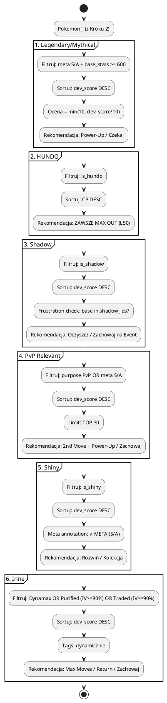

###

---

#### Sekcja 7: Ranking Rozwoju (Development Score)

##### Co robimy?

Ranking wszystkich Pokemon w kolekcji wg `dev_score` (0-100). Szczegółowy algorytm z pętlami, switch/case, detach i notatkami.

##### Podsumowanie algorytmu

```
PETLA GLOWNA (per Pokemon):

  FAZA 1: Wczesne wykluczenie (najtaniej najpierw)
  - Przeznaczenie = "Transfer" lub "Kolekcja" → detach
  - Jest Shadow? → Ma Frustration? → Jest event usuwajacy Frustration?
    - TAK: Kontynuuj analize
    - NIE: Oznacz do pominiecia → detach

  FAZA 2: League Cap Check (oblicz raz)
  - Oblicz max_safe_gl i max_safe_ul (binary search po CPM table)
  - cap_status = AT CAP → Oznacz jako gotowe → detach
  - cap_status = Blisko → cap_gl/ul/ml = "Blisko capu"
  - cap_status = Bezpiecznie → cap_gl/ul/ml = "Bezpiecznie"
  - cap_status = Niski → cap_gl/ul/ml = "Niski CP"
  - Wykryj Target League: goal > purpose > tags > AUTO

  FAZA 3: Scoring Components (0-100 pkt)
  - Wynik = 0
  - IV% (0-15): min(IV% / 100 * 15, 15)
  - Lucky (0-20): +20 jeśli Lucky (50% Stardust discount)
  - Meta Tier (0-20): switch(Tier) → S=20, A=15, B=8, C=0
  - Moveset (0-15): +5 per meta move (fast/ch1/ch2), note: "Zmien na: {best_move}"
  - Mega/Shadow Potential (0-10):
    - Forma Mega w Tier S/A i NIE jest mega → +5
    - Forma Shadow w Tier S i NIE jest shadow/purified → +5
  - CP Investment (0-10): cp / max_cp_L50 * 10
  - Purpose Bonus (0-10): switch(Przeznaczenie) → Rajdy lub PvP=+8, Kolekcja=+3, Inne=0
  - Wynik = max(0, Wynik) (zakres: 0-100)

PO PETLI:

  Sortowanie: Sortuj po Wynik DESC
  Drugorzedne: IV% DESC, CP DESC
  BEZ deduplikacji (Kazdy UID = osobny pokemon)

  Output: Tabela Markdown
  Header: # | UID | Pokemon | Score | IV% | Lucky | Shadow | Tier | CP | Target Liga | GL Status | UL Status | ML Status | Moveset | Przeznaczenie
```

##### Scoring: dev_score (0-100)

| Komponent | Max pkt | Logika |
|-----------|---------|--------|
| IV% | 15 | `min(IV% / 100 * 15, 15)` |
| Lucky | 20 | +20 jeśli lucky (50% Stardust discount) |
| Meta Tier | 20 | S=20, A=15, B=8, C=0 |
| Moveset | 15 | +5 per meta move (fast, ch1, ch2); note: "Zmien na: {best_move}" |
| Mega/Shadow potential | 10 | +5 (Mega w Tier S/A, nie jest mega); +5 (Shadow w Tier S, nie jest shadow/purified) |
| CP Investment | 10 | `cp / max_cp_L50 * 10` |
| Purpose bonus | 10 | Rajdy lub PvP=+8, Kolekcja=+3, Inne=0 |

##### Diagram — PlantUML

```plantuml
@startuml

' ============================================
' SEKCJA 7 - PIPELINE RANKINGU ROZWOJU
' Styl: programowy (petle, if/endif, warunkowy scoring)
' Cel: diagram przeplywu do implementacji w innym jezyku
' ============================================

start

:Wczytaj liste pokemonów z pliku ODS
jako liste wejsciowa;

if (Wejscie < 1) then (TAK)
    stop
endif

' ============================================
' PETLA GLOWNA - analiza kazdego pokemon
' ============================================
repeat

    ' --- FAZA 1: Wczesne wykluczenie (najtaniej najpierw) ---

    partition "Wykluczanie niepotrzebnych" {

        if (Przeznaczenie = "Transfer" lub "Kolekcja"?) then (TAK)
            :Oznacz do pominiecia;
            detach
        endif

        if (Jest Shadow?) then (TAK)
            if (Ma Frustration?) then (TAK)
                if (Jest event usuwajacy Frustration?) then (TAK)
                    :Kontynuuj analize;
                else (NIE)
                    :Oznacz do pominiecia;
                    detach
                endif
            endif
        endif
    }

    ' --- FAZA 2: League Cap (oblicz raz, uzyj wielokrotnie) ---

    partition "League Cap Check" {
        :Oblicz max_safe_gl i max_safe_ul
        (binary search po CPM table);

        switch (cap_status)
        case (AT CAP)
            :Oznacz jako gotowe;
            detach
        case (Blisko)
            :cap_gl = "Blisko capu"
            cap_ul = "Blisko capu"
            cap_ml = "Blisko capu";
        case (Bezpiecznie)
            :cap_gl = "Bezpiecznie"
            cap_ul = "Bezpiecznie"
            cap_ml = "Bezpiecznie";
        case (Niski)
            :cap_gl = "Niski CP"
            cap_ul = "Niski CP"
            cap_ml = "Niski CP";
        endswitch

        :Wykryj Target League
        (goal > purpose > tags > AUTO);
    }

    ' --- FAZA 3: Scoring (0-100 pkt) ---

    partition "Scoring Components (0-100)" {

        ' Inicjalizacja
        :Wynik = 0;

        ' === IV% (0-15 pkt) ===
        :Wynik += min(IV% / 100 * 15, 15);

        ' === Lucky (0-20 pkt) ===
        if (Lucky?) then (TAK)
            :Wynik += 20
            (50% Stardust discount);
        endif

        ' === Meta Tier (0-20 pkt) ===
        switch (Tier)
        case (S)
            :Wynik += 20
            (Must-have meta);
        case (A)
            :Wynik += 15
            (Strong meta);
        case (B)
            :Wynik += 8
            (Niche);
        case (C)
            :Wynik += 0
            (Dex filler);
        endswitch

        ' === Moveset (0-15 pkt + informacja) ===
        if (Szybki atak jest meta?) then (TAK)
            :Wynik += 5;
        else (NIE)
            note right: Zmien na: {best_fast_move}
        endif
        if (Charged 1 jest meta?) then (TAK)
            :Wynik += 5;
        else (NIE)
            note right: Zmien na: {best_charged1}
        endif
        if (Charged 2 jest meta?) then (TAK)
            :Wynik += 5;
        else (NIE)
            note right: Zmien na: {best_charged2}
        endif

        ' === Mega/Shadow Potential (0-10 pkt) ===
        if (Forma Mega istnieje w Tier S/A
            i NIE jest mega?) then (TAK)
            :Wynik += 5;
        endif
        if (Forma Shadow istnieje w Tier S
            i NIE jest shadow/purified?) then (TAK)
            :Wynik += 5;
        endif

        ' === Investment Feasibility (0-10 pkt) ===
        :CP Investment (0-10): cp / max_cp_L50 * 10;
        :Wynik += CP Investment;

        ' === Purpose Bonus (0-10 pkt) ===
        switch (Przeznaczenie)
        case (Rajdy lub PvP)
            :Wynik += 8;
        case (Kolekcja)
            :Wynik += 3;
        case (Inne)
        endswitch

        ' === Zabezpieczenie ===
        :Wynik = max(0, Wynik)
        (zakres: 0-100);
    }

repeat while (Jest nastepny pokemon?) is (TAK)

' ============================================
' SORTOWANIE
' ============================================

partition "Sortowanie" {
    :Sortuj po Wynik DESC;
    :Drugorzedne: IV% DESC, CP DESC;
    :BEZ deduplikacji
    (Kazdy UID = osobny pokemon);
}

' ============================================
' WYJSCIE
' ============================================

partition "Output - Tabela Markdown" {
    :Naglowek: # | UID | Pokemon | Score | IV% | Lucky | Shadow | Tier | CP | Target Liga | GL Status | UL Status | ML Status | Moveset | Przeznaczenie;
    :Dla kazdego pokemon w kolejnosci:
    formatuj wiersz tabeli;
}

stop

@enduml
```

##### Diagram — Mermaid


---

### 4. Prezentacja wyników

##### Co robimy?

Generujemy dwa pliki wyjściowe: JSON snapshot (dane surowe) i Markdown raport (7 sekcji z analizą). Brak post-processingu.

##### Kolejność zapisu

```
1. JSON snapshot → zapisz PRZED raportem
2. Markdown report → zapisz PO snapshotcie
```

> JSON jest zapisywany pierwszy — gdyby raport się nie powiódł, dane są bezpieczne.

##### Pliki wyjściowe

| Plik | Wzorzec | Zawartość |
|------|---------|-----------|
| **JSON snapshot** | `analizy/collection-{konto}-YYYYMMDD.json` | Cała kolekcja (JSON array, indent=2) |
| **Markdown report** | `analizy/Analiza-YYYYMMDD-opencode-{konto}.md` | 7 sekcji analizy |

##### JSON Snapshot

```yaml
CollectionSnapshot:
  type: array
  items:
    $ref: "#/components/schemas/Pokemon"
  description: "Cała kolekcja po wzbogaceniu (enrichment)"
  format: "JSON array, indent=2, ensure_ascii=False"
```

| Pole | Źródło |
|------|--------|
| Podstawowe | uid, species, nick, cp, iv_a/d/h, fast, ch1, ch2, purpose, tags, date |
| Wzbogacone | iv_pct, is_lucky, is_shiny, is_shadow, is_purified, is_dynamax, is_traded, is_hundo |
| Meta | species_id, base_stats, types, fast_moves, charged_moves, meta_tier, dev_score |

##### Markdown Report — Struktura

| # | Nagłówek | Zawartość |
|---|----------|-----------|
| **1** | `## 1. Ogolne podsumowanie` | Statystyki kolekcji, TOP 10 HUNDO, TOP 10 wg CP, TOP 10 Dynamax, TOP 10 Shadow, TOP 10 Shiny, TOP 10 Power-Up, TOP 10 Dev Score, Meta vs Collection, uwagi ogólne |
| **2** | `## 2. Zestawy do Rajdow` | Tier List (S/A/B/C) z Pokemon po filtrze purpose |
| **3** | `## 3. Zestawy do PvP` | Great/Ultra/Master League, druzyny 3v3 (Lead/Switch/Closer) |
| **4** | `## 4. Kandydaci do Transferu` | Bezpieczne (max 30) + NIE TRANSFERUJ (zasady) |
| **5** | `## 5. Poszukiwani do statusu Lucky` | Priority 1/2 + Strategia |
| **6** | `## 6. Szczegolowa analiza` | 6 podkategorii z oceną 1-10 |
| **7** | `## 7. Wszystkie Pokemon-y` | Tabela Markdown (full ranking, wszystkie Pokemon) |

##### Szablon raportu Markdown

> Poniżej pełny szablon. `{zmienna}` = wartość dynamiczna z danych.

```
# Analiza Pokemon — {konto} — {data}

---

## 1. Ogolne podsumowanie

### Podsumowanie kolekcji

- **Laczna ilosc Pokemon:** {total}
- **Shiny:** {shiny_count} ({shiny_pct}%)
- **Lucky:** {lucky_count} ({lucky_pct}%)
- **Shadow:** {shadow_count} ({shadow_pct}%)
- **Purified:** {purified_count} ({purified_pct}%)
- **Dynamax:** {dynamax_count} ({dynamax_pct}%)
- **Trade'owane:** {traded_count} ({traded_pct}%)
- **HUNDO (100% IV):** {hundo_count} ({hundo_pct}%)
- **High IV (>=90%):** {high_iv_count} ({high_iv_pct}%)
- **Rodziny ewolucyjne:** {family_count}

### TOP 10 HUNDO
| # | Pokemon | CP | Lucky | Purpose |
|--:|---------|---:|:-----:|---------|
| 1 | **{species}** | {cp} | {lucky} | {purpose} |
| ... | ... | ... | ... | ... |

### TOP 10 CP
| # | Pokemon | CP | IV% | Lucky | Purpose |
|--:|---------|---:|----:|:-----:|---------|
| 1 | **{species}** | {cp} | {iv_pct}% | {lucky} | {purpose} |
| ... | ... | ... | ... | ... | ... |

### TOP 10 Dynamax
| # | Pokemon | CP | IV% | Tier |
|--:|---------|---:|----:|:----:|
| 1 | **{species}** | {cp} | {iv_pct}% | {meta_tier} |
| ... | ... | ... | ... | ... |

### TOP 10 Shadow
| # | Pokemon | CP | IV% | Tier | Score |
|--:|---------|---:|----:|:----:|------:|
| 1 | **{species}** | {cp} | {iv_pct}% | {meta_tier} | {dev_score} |
| ... | ... | ... | ... | ... | ... |

### TOP 10 Shiny
| # | Pokemon | CP | IV% | Tier | Lucky |
|--:|---------|---:|----:|:----:|:-----:|
| 1 | **{species}** | {cp} | {iv_pct}% | {meta_tier} | {lucky} |
| ... | ... | ... | ... | ... | ... |

### TOP 10 Power-Up
| # | Pokemon | CP | IV% | Tier | Score |
|--:|---------|---:|----:|:----:|------:|
| 1 | **{species}** | {cp} | {iv_pct}% | {meta_tier} | {dev_score} |
| ... | ... | ... | ... | ... | ... |

_Wykluczone: Pokemon z Purpose=PvP na GL cap (CP≥1450) oraz Pokemon na max CP. Sortowanie wg DevScore._

### TOP 10 Dev Score
| # | Pokemon | CP | IV% | Tier | Score |
|--:|---------|---:|----:|:----:|------:|
| 1 | **{species}** | {cp} | {iv_pct}% | {meta_tier} | {dev_score} |
| ... | ... | ... | ... | ... | ... |

### Uwagi ogolne
- Lucky rate: {lucky_pct}% ({lucky_count}/{total})
- Candy XL: {bottleneck_info}
- Shadow/Purified: {shadow_info}
- Dynamax: {dynamax_info}

---

## 2. Zestawy do Rajdow — Tier List

### Tier S
- **{species}** — IV {iv_pct}%, CP {cp}, Moves: {fast}/{ch1}/{ch2}, Lucky: {lucky_star}
...

### Tier A
...

### Tier B
...

### Tier C
...

### Priorytet inwestycji
1. {investment_1}
2. {investment_2}
3. {investment_3}
4. {investment_4}
5. {investment_5}

---

## 3. Zestawy do PvP — Gotowe druzyny 3v3

### Great League (1500 CP)

**Druzyna A:**
- **Lead:** {species} — IV {iv_pct}%, CP {cp}
- **Switch:** {species} — IV {iv_pct}%, CP {cp}
- **Closer:** {species} — IV {iv_pct}%, CP {cp}

**Druzyna B:**
- **Lead:** ...
- **Switch:** ...
- **Closer:** ...

### Ultra League (2500 CP)

**Druzyna A:**
- **Lead:** ...
- **Switch:** ...
- **Closer:** ...

### Master League (bez limitu CP)

**Druzyna A:**
- **Lead:** ...
- **Switch:** ...
- **Closer:** ...

### Kluczowe Pokemon
- {species1}
- {species2}
- ...

---

## 4. Kandydaci do Transferu

### Bezpieczne do transferu ({safe_count} szt.)

Kryteria: IV < 90%, nie shiny, nie lucky, nie shadow, nie hundo, nie tier S, nie (tier A + IV >= 70%), nie purpose kolekcja/trade.

- **{species}** — IV {iv_pct}%, CP {cp}, Tier {meta_tier}
- **{species}** — IV {iv_pct}%, CP {cp}, Tier {meta_tier}
... (max 30)

### NIE TRANSFERUJ (zachowaj)
- **Shiny** — nawet slabych IV, unikalne
- **Lucky** — 50% Stardust discount, wartosc handlowa
- **Shadow** — potencjal Frustration → Return po eventach
- **HUNDO (100% IV)** — perfekcyjne IV
- **High IV (>=90%) + meta S/A** — meta-relevantne
- **Kolekcja / Trade / Lucky Trade** — oznaczone przez uzytkownika
- **Dynamax** — nowa mechanika, Max Moves
- **Purified + Return** — przydatne w PvP

---

## 5. Poszukiwani do statusu Lucky — Priorytety Lucky Trades

### Priorytet 1: Legendary / Mythical (Meta S-tier)
- **{species}** — {reason} — ✅ MASZ Lucky
- **{species}** — {reason} — ❌ BRAK Lucky
... (dynamicznie z gamemaster + meta_rankings)

### Priorytet 2: Shadow-eligible Meta
- **{species}** — Masz Shadow | ✅ Masz Lucky
- **{species}** — Brak
... (dynamicznie z gamemaster + meta_rankings)

### Strategia Lucky Trade
1. Handel to jedyny sposob na uzyskanie Lucky — im wiecej handlujesz, tym wyzszy rate
2. Gwarantowany Lucky Trade (Lucky Friend) przeznaczaj na legendy, ktorych nie masz
3. Nie handluj HUNDO — juz sa idealne
4. Im starszy Pokemon (wiek w kolekcji), tym wyzszy szansa na Lucky
5. Candy XL z handlu zalezy od odleglosci łapania (100km+ = 100% szansa XL)

---

## 6. Szczegolowa analiza — Ocena 1-10

### Legendary / Mythical
- **{species}** — Ocena: {ocena}/10, IV {iv_pct}%, Lucky: {lucky}, CP {cp}, Zastosowanie: {purpose}, Rekomendacja: {rekomendacja}
...

### HUNDO
- **{species}** — CP {cp}, Lucky: {lucky}, Shadow: {shadow}, Rekomendacja: MAX OUT (L50)
...

### Shadow — Frustration → Return
- **{species}** — IV {iv_pct}%, Lucky: {lucky}, Frustration removable: {frustration}, Rekomendacja: {rekomendacja}
...

### PvP Relevant
- **{species}** — IV {iv_pct}%, CP {cp}, Lucky: {lucky}, Moves: {fast}/{ch1}/{ch2}, Rekomendacja: {rekomendacja}
... (TOP 30)

### Shiny
- **{species}** — IV {iv_pct}%, Lucky: {lucky} ⭐ META, Rekomendacja: {rekomendacja}
...

### Inne (Dynamax / Purified / Traded)
- **{species}** — IV {iv_pct}%, Tags: {tags}, Rekomendacja: {rekomendacja}
...

---

## 7. Wszystkie Pokemon-y — Ranking Rozwoju ({total} sztuk)

| # | UID | Pokemon | Score | IV% | Lucky | Shadow | Tier | CP | PvP Liga | Fast / Charged 1 / Charged 2 | Przeznaczenie |
|---|-----|---------|------:|----:|:-----:|:------:|:----:|---:|:---------|:-----------------------------|:-------------|
| 1 | {uid} | **{species}** {emoji} | {score:.1f} | {iv_pct:.1f}% | {lucky} | {shadow} | {tier} | {cp:>4} | {league} | {fast} / {ch1} / {ch2} | {purpose} |
| 2 | ... | ... | ... | ... | ... | ... | ... | ... | ... | ... | ... |
```

##### Formatowanie — szczegóły

| Element | Format | Opis |
|---------|--------|------|
| **Nazwa Pokemon** | `**{species}**` | Pogrubiona |
| **Emotikonki** | `{emoji}` | `✨` Shiny, `👻` Shadow, `⭐` Lucky (w liście) |
| **Lucky (tabela)** | `✅` / puste | Tylko `✅` gdy lucky |
| **Shadow (tabela)** | `👻` / puste | Tylko `👻` gdy shadow |
| **Score** | `{score:.1f}` | Jeden decimal place |
| **IV%** | `{iv_pct:.1f}%` | Jeden decimal + % |
| **CP** | `{cp:>4}` | Right-aligned, 4 chars |
| **Separatory list** | `- **{species}** — ...` | Myślinik, pauza, pola z przecinkami |
| **Separatory TOP 10** | `1. **{species}** — ...` | Numeracja, pauza |
| **Tabela** | Pipe table `| ... |` | Separator header `|---:|` |

##### Sekcja 7 — Tabela Markdown

```
Header: # | UID | Pokemon | Score | IV% | Lucky | Shadow | Tier | CP | PvP Liga | Fast / Charged 1 / Charged 2 | Przeznaczenie
```

| Kolumna | Format | Opis |
|---------|--------|------|
| # | `int` | Numer rankingu |
| UID | `string` | Unikalny identyfikator |
| Pokemon | `string` | Nazwa + emotikonki (✨, 👻) |
| Score | `float` | dev_score (0-100) |
| IV% | `float` | Procent IV |
| Lucky | `✅/❌` | Czy jest Lucky |
| Shadow | `👻` | Czy jest Shadow |
| Tier | `S/A/B/C` | Meta tier |
| CP | `int` | Combat Power |
| PvP Liga | `string` | Status ligi (GL/UL/ML) |
| Moves | `string` | fast / ch1 / ch2 |
| Przeznaczenie | `string` | Purpose |

##### Post-processing

**Brak.** Po zapisie:
- Weryfikacja: brak
- Konwersja: brak
- Cleanup: brak
- Notyfikacja: brak

##### Diagram — Krok 4

###### PlantUML

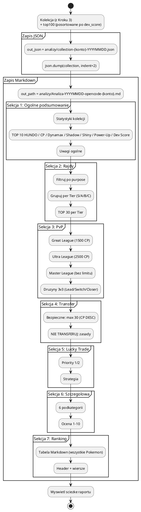

###
