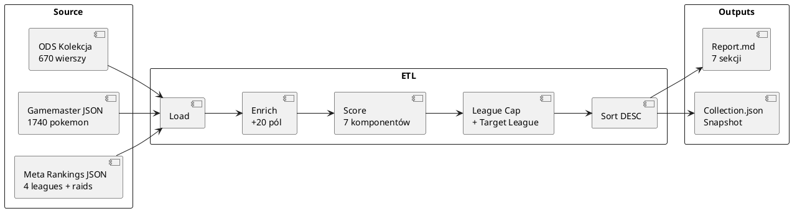

# Rejestr Danych - Mapowanie Pól

> **Cel:** Pełny rejestr pól danych - mapowanie między ODS (Arkusz Kolekcja), JSON Collection, Gamemaster, a wewnętrznymi strukturami kodu.

---

## Arkusz Kolekcja (ODS) → JSON Collection → Internal

| ODS Kolumna | Litera | JSON Key | Internal Field | Typ | Opis / Transformacja |
|-------------|--------|----------|----------------|-----|---------------------|
| UID | A | `uid` | `uid` | string | Identyfikator `P-XXXXX` |
| Gatunek | B | `species` | `species` | string | Nazwa z normalizacją `'(Forma)' → ' - Forma'` |
| Własna nazwa | C | `nick` | `nick` | string | Opcjonalna nazwa własna |
| Typ 1 | D | - | `types[0]` | string | Z Pokedex (VLOOKUP) |
| Typ 2 | E | - | `types[1]` | string | Z Pokedex (VLOOKUP) |
| CP | F | `cp` | `cp` | int/None | Obecne CP |
| IV Atk | G | `iv_a` | `iv_a` | int/None | IV Atak (0-15) |
| IV Def | H | `iv_d` | `iv_d` | int/None | IV Obrona (0-15) |
| IV HP | I | `iv_h` | `iv_h` | int/None | IV HP (0-15) |
| IV % | J | - | `iv_pct` | float | Obliczone: `(Atk+Def+HP)/45*100` |
| Fast Attack | K | `fast` | `fast` | string | Szybki atak |
| Charged Attack 1 | L | `ch1` | `ch1` | string | Ładowany atak 1 |
| Charged Attack 2 | M | `ch2` | `ch2` | string | Ładowany atak 2 |
| Shiny | N | - | `is_shiny` | bool | `tags` contains 'Shiny' |
| Lucky | O | - | `is_lucky` | bool | `tags` contains 'Lucky' |
| Shadow | P | - | `is_shadow` | bool | `tags` contains 'Shadow' |
| Purified | Q | - | `is_purified` | bool | `tags` contains 'Purified' |
| Dynamax | R | - | `is_dynamax` | bool | `tags` contains 'Dynamax' |
| Traded | S | - | `is_traded` | bool | `tags` contains 'Traded' |
| Inne cechy | T | `tags` | `tags` | string | Pozostałe tagi (poza standardowymi) |
| Data złapania | U | `date` | `date` | string | Data w formacie YYYY-MM-DD |
| Przeznaczenie | V | `purpose` | `purpose` | string | Cel: PvP, Rajdy, Gym, Trade, Transfer, Kolekcja |
| Priorytet Rozwoju | W | `priority` | `priority` | string | Priorytet 1-5 |
| Decyzja | X | `decision` | `decision` | string | ROZWIŃ, PRETENDENT, TRADE, PROFESOR, ZACHOWAJ |
| Cel rozwoju | Y | `goal` | `goal` | string | Cel rozwoju (np. Great League, Ultra League) |
| Powód decyzji | Z | `reason` | `reason` | string | Uzasadnienie decyzji |
| Uwagi | AA | `notes` | `notes` | string | Dowolne uwagi |

---

## Gamemaster JSON → Internal Structures

### Pokemon Entry (z gamemaster.pokemon[])

| Gamemaster Field | Internal Key | Typ | Opis |
|-----------------|--------------|-----|------|
| `dex` | `dex` | int/string | Numer Pokédex |
| `speciesId` | `species_id` | string | Unikalny ID (np. `mewtwo`, `charizard_mega_y`) |
| `speciesName` | `species_name` | string | Nazwa (unnormalized) |
| `types[]` | `types` | List[string] | Typy (np. `['fire', 'flying']`) |
| `baseStats.{atk,def,hp}` | `base_stats` | Dict | Bazowe statystyki |
| `fastMoves[]` | `fast_list` | List[string] | Move ID szybkich ataków |
| `chargedMoves[]` | `charged_list` | List[string] | Move ID ładowanych ataków |
| `tags[]` | `tags` | List[string] | Tagi (shadoweligible, megaeligible, itp.) |
| `released` | - | bool | Czy dostępny w grze |

### Moves Entry (z gamemaster.moves[])

| Gamemaster Field | Internal Key | Typ | Opis |
|-----------------|--------------|-----|------|
| `moveId` | `move_id` | string | Unikalny ID ruchu |
| `name` | `name` | string | Nazwa ruchu |
| `type` | `type` | string | Typ ruchu |
| `power` | `power` | int | Moc |
| `energyGain` | `energy_gain` | int | Energia (zysk - dla fast) |
| `energyCost` | `energy_cost` | int | Energia (koszt - dla charged) |
| `cooldownMs` | `cooldown_ms` | int | Cooldown (ms) - fast moves |
| `turns` | `turns` | int | Tury - charged moves |
| `buffs` | `buffs` | List | Buffeny (opcjonalne) |

### Meta Rankings (z cache PvPoke)

| JSON Key | Internal Structure | Typ |
|----------|-------------------|-----|
| `rankings.great_league_overall` | `List[speciesId]` | Top 100+ |
| `rankings.ultra_league_overall` | `List[speciesId]` | Top 100+ |
| `rankings.master_league_overall` | `List[speciesId]` | Top 100+ |
| `rankings.raid_attackers` | `List[speciesId]` | Top 100+ |

### Meta Tiers (Internal Computed)

| Internal Set | Źródło | Opis |
|-------------|--------|------|
| `_META_TIER_S` | Set[string] | Top 20 z rankings + fallback S |
| `_META_TIER_A` | Set[string] | 21-50 z rankings + fallback A |
| `_META_TIER_B` | Set[string] | 51-100 z rankings + fallback B |

---

## Internal Pokemon Dict (Enriched)

Po fazie Enrichment, każdy pokemon to dict z polami:

| Internal Key | Źródło | Typ | Opis |
|-------------|--------|-----|------|
| `uid` | ODS A | string | `P-XXXXX` |
| `species` | ODS B (norm.) | string | Nazwa znormalizowana |
| `nick` | ODS C | string | Nazwa własna |
| `cp` | ODS F | int/None | Obecne CP |
| `iv_a`, `iv_d`, `iv_h` | ODS G,H,I | int/None | IVs |
| `iv_pct` | Computed | float | `(Atk+Def+HP)/45*100` |
| `fast` | ODS K | string | Fast move name |
| `ch1` | ODS L | string | Charged 1 name |
| `ch2` | ODS M | string | Charged 2 name |
| `purpose` | ODS V | string | Przeznaczenie |
| `goal` | ODS Y | string | Cel rozwoju |
| `decision` | ODS X | string | Decyzja |
| `priority` | ODS W | string | Priorytet |
| `reason` | ODS Z | string | Powód |
| `notes` | ODS AA | string | Uwagi |
| `tags` | ODS T + N-S | string | Wszystkie tagi |
| `is_shiny` | Computed | bool | 'Shiny' in tags |
| `is_lucky` | Computed | bool | 'Lucky' in tags |
| `is_shadow` | Computed | bool | 'Shadow' in tags |
| `is_purified` | Computed | bool | 'Purified' in tags |
| `is_dynamax` | Computed | bool | 'Dynamax' in tags |
| `is_traded` | Computed | bool | 'Traded' in tags |
| `is_hundo` | Computed | bool | `iv_pct == 100.0` |
| `species_id` | Mapped | string | z `name_to_species` |
| `base_stats` | Gamemaster | Dict | `{atk, def, hp}` |
| `types` | Gamemaster | List[str] | `['fire', 'flying']` |
| `fast_list` | Gamemaster | List[str] | Fast move names |
| `charged_list` | Gamemaster | List[str] | Charged move names |
| `meta_tier` | Computed | str | 'S'/'A'/'B'/'C' |
| `max_safe_gl` | Computed | float | Max level dla CP ≤ 1500 |
| `max_safe_ul` | Computed | float | Max level dla CP ≤ 2500 |
| `target_league` | Computed | str | 'GL'/'UL'/'ML'/'AUTO' |
| `current_level` | Computed | float | Szacunkowy poziom |
| `dev_score` | Computed | float | Score 0-100 |

---

## Collection JSON (Snapshot) - Struktura Pliku

```json
{
  "metadata": {
    "account": "{konto}",
    "generated_at": "2026-09-06T10:15:00",
    "total_pokemon": 670,
    "gamemaster_version": "2026-09-06"
  },
  "pokemon": [
    {
      "uid": "P-00146",
      "species": "Gyarados",
      "nick": "",
      "cp": 2496,
      "iv_a": 14,
      "iv_d": 13,
      "iv_h": 15,
      "iv_pct": 91.1,
      "fast": "Bite",
      "ch1": "Crunch",
      "ch2": "Hydro Pump",
      "purpose": "PvP",
      "goal": "",
      "decision": "",
      "priority": "",
      "reason": "",
      "notes": "",
      "tags": "Lucky, Traded, Ultra League",
      "is_shiny": false,
      "is_lucky": true,
      "is_shadow": false,
      "is_purified": false,
      "is_dynamax": false,
      "is_traded": true,
      "is_hundo": false,
      "species_id": "gyarados",
      "base_stats": {"atk": 237, "def": 197, "hp": 216},
      "types": ["water", "flying"],
      "fast_list": ["Bite", "Dragon Breath", "Waterfall"],
      "charged_list": ["Crunch", "Hydro Pump", "Outrage", "Aqua Tail"],
      "meta_tier": "A",
      "max_safe_gl": 0,
      "max_safe_ul": 29.5,
      "target_league": "UL",
      "current_level": 29.5,
      "dev_score": 86.2
    }
  ]
}
```

---

## Raport Markdown - Mapowanie Sekcji na Dane

| Sekcja | Źródło Danych | Kluczowe Pola |
|--------|--------------|---------------|
| 1. Podsumowanie | `enriched_pokemon[]` | `len()`, `sum(is_shiny)`, `sum(is_lucky)`, `sum(is_hundo)`, `Counter(purpose)`, `sorted(iv_pct)`, `sorted(cp)` |
| 2. Rajdy | `enriched_pokemon[]` | `meta_tier`, `cp`, `iv_pct`, `is_lucky`, `fast`, `ch1`, `ch2` |
| 3. PvP | `enriched_pokemon[]` | `cp`, `meta_tier`, `iv_pct`, `is_lucky`, `max_safe_gl`, `max_safe_ul`, `target_league` |
| 4. Transfer | `enriched_pokemon[]` | `iv_pct`, `is_shiny`, `is_lucky`, `is_shadow`, `is_hundo`, `meta_tier`, `purpose` |
| 5. Lucky Trade | `enriched_pokemon[]` | `is_lucky`, `meta_tier`, `species`, `species_id`, `is_shadow` |
| 6. Szczegółowa | `enriched_pokemon[]` | Wszystkie pola wg kategorii |
| 7. Ranking | `enriched_pokemon[]` | `dev_score`, `iv_pct`, `is_lucky`, `is_shadow`, `meta_tier`, `cp`, `current_level`, `max_safe_gl/ul`, `target_league`, `fast`, `ch1`, `ch2`, `purpose` |

---

## Przepływ Danych - Podsumowanie



---

## Słownik Transformacji (ETL Rules)

| Rule ID | Źródło | Cel | Transformacja |
|---------|--------|-----|--------------|
| R01 | ODS B (Gatunek) | Internal `species` | `normalize_name()` → `'(Forma)' → ' - Forma'` |
| R02 | ODS N-S (checkboxes) | `is_shiny`...`is_traded` | `bool = 'X' in cell` |
| R03 | ODS G,H,I | `iv_pct` | `(G+H+I)/45*100` z precyzją 0.1% |
| R04 | ODS B + Gamemaster | `species_id` | `normalize(ODS_B)` → lookup w `name_to_species` |
| R05 | ODS V + Y + Tags | `target_league` | Priority: `goal` > `purpose` > `tags` > AUTO |
| R06 | `cp` + `base_stats` + CPM | `current_level` | Binary search po CPM table (precyzja 0.5 lvl) |
| R07 | `base_stats` + `ivs` + CPM table | `max_safe_gl/ul` | Binary search: max level gdzie CP ≤ cap |
| R08 | `species_id` + `_META_TIER_S/A/B` | `meta_tier` | Check: species_id, species_id_shadow, species_id_mega, base |
| R09 | `species_id` + `_META_TIER_S/A` | Mega/Shadow bonus | Check: base_mega w S/A, base_shadow w S |
| R10 | `base_stats` + CPM table | `max_cp_40`, `max_cp_50` | `max_cp(atk+15, def+15, hp+15, CPM_40/50)` |

---

## Walidacja Integralności

| Check | Warunek | Błąd Jeśli |
|-------|---------|------------|
| UID Uniqueness | `len(uids) == len(set(uids))` | Duplicate UID |
| No Data Loss | `len(enriched) == len(ods_rows)` | Lost rows |
| IV% Range | `0 <= iv_pct <= 100` | Invalid IV |
| CP Range | `cp >= 0` | Negative CP |
| Level Range | `1 <= current_level <= 50` | Invalid level |
| Max Safe Level | `max_safe_gl <= max_safe_ul` | Logic error |
| Score Range | `0 <= dev_score <= 100` | Scoring bug |
| League Status | Non-empty string | Missing logic |