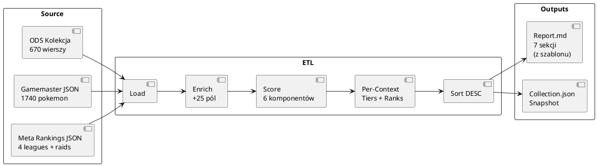

# Rejestr Danych - Mapowanie Pól

> **Cel:** Pełny rejestr pól danych - mapowanie między ODS (Arkusz Kolekcja), JSON Collection, Gamemaster, a wewnętrznymi strukturami kodu.

---

## Arkusz Kolekcja (ODS) → JSON Collection → Internal

| ODS Kolumna | Litera | JSON Key | Internal Field | Typ | Opis / Transformacja |
|-------------|--------|----------|----------------|-----|---------------------|
| UID | A | `uid` | `uid` | string | Identyfikator `P-XXXXX` |
| Gatunek | B | `species` | `species` | string | Nazwa z normalizacją `'(Forma)' → ' - Forma'` |
| Własna nazwa | C | `nick` | `nick` | string | Opcjonalna nazwa własna |
| Typ 1 | D | - | `types[0]` | string | Z Pokedex (VLOOKUP) |
| Typ 2 | E | - | `types[1]` | string | Z Pokedex (VLOOKUP) |
| CP | F | `cp` | `cp` | int/None | Obecne CP |
| IV Atk | G | `iv_a` | `iv_a` | int/None | IV Atak (0-15) |
| IV Def | H | `iv_d` | `iv_d` | int/None | IV Obrona (0-15) |
| IV HP | I | `iv_h` | `iv_h` | int/None | IV HP (0-15) |
| IV % | J | - | `iv_pct` | float | Obliczone: `(Atk+Def+HP)/45*100` |
| Fast Attack | K | `fast` | `fast` | string | Szybki atak |
| Charged Attack 1 | L | `ch1` | `ch1` | string | Ładowany atak 1 |
| Charged Attack 2 | M | `ch2` | `ch2` | string | Ładowany atak 2 |
| Shiny | N | - | `is_shiny` | bool | `tags` contains 'Shiny' |
| Lucky | O | - | `is_lucky` | bool | `tags` contains 'Lucky' |
| Shadow | P | - | `is_shadow` | bool | `tags` contains 'Shadow' |
| Purified | Q | - | `is_purified` | bool | `tags` contains 'Purified' |
| Dynamax | R | - | `is_dynamax` | bool | `tags` contains 'Dynamax' |
| Traded | S | - | `is_traded` | bool | `tags` contains 'Traded' |
| Inne cechy | T | `tags` | `tags` | string | Pozostałe tagi (poza standardowymi) |
| Data złapania | U | `date` | `date` | string | Data w formacie YYYY-MM-DD |
| Przeznaczenie | V | `purpose` | `purpose` | string | Cel: PvP, Rajdy, Gym, Trade, Transfer, Kolekcja |
| Priorytet Rozwoju | W | `priority` | `priority` | string | Priorytet 1-5 |
| Decyzja | X | `decision` | `decision` | string | ROZWIŃ, PRETENDENT, TRADE, PROFESOR, ZACHOWAJ |
| Cel rozwoju | Y | `goal` | `goal` | string | Cel rozwoju (np. Great League, Ultra League) |
| Powód decyzji | Z | `reason` | `reason` | string | Uzasadnienie decyzji |
| Uwagi | AA | `notes` | `notes` | string | Dowolne uwagi |

---

## Enriched Pokemon (po wzbogaceniu)

| Field | Typ | Opis |
|-------|-----|------|
| `iv_pct` | float64 | Obliczone: `(IVAtk+IVDef+IVHP)/45*100` |
| `is_hundo` | bool | `IVPct == 100.0` |
| `species_id` | string | Znormalizowany ID z gamemaster |
| `base_stats` | BaseStats | Bazowe atk/def/hp z gamemaster |
| `types` | []string | Typy z gamemaster (np. `["dragon", "ground"]`) |
| `fast_moves` | []string | Dostępne szybkie ruchy z gamemaster |
| `charged_moves` | []string | Dostępne charged ruchy z gamemaster |
| `family_id` | string | ID rodziny ewolucyjnej |
| `tags` | []string | Dodatkowe tagi (z kol T ODS) |
| `max_cp` | int | Max CP na lvl 50 z IV 15/15/15 (`CalculateMaxCP`) |
| **Per-context meta tiers** | | |
| `raid_tier` | string | Tier raidowy (S/A+/A/B+/B/C/D) |
| `gl_tier` | string | Tier Great League |
| `ul_tier` | string | Tier Ultra League |
| `ml_tier` | string | Tier Master League |
| **Per-context ranking positions** | | |
| `raid_rank` | int | Pozycja w rankingu raid (0-indexed, -1 = brak) |
| `gl_rank` | int | Pozycja w rankingu GL |
| `ul_rank` | int | Pozycja w rankingu UL |
| `ml_rank` | int | Pozycja w rankingu ML |
| **Per-context scores** | | |
| `raid_score` | float64 | Score raidowy (0-100) |
| `gl_score` | float64 | Score GL (0-100) |
| `ul_score` | float64 | Score UL (0-100) |
| `ml_score` | float64 | Score ML (0-100) |
| **DevScore** | | |
| `dev_score` | float64 | Score rozwoju 0-100 (kontekstowy: najlepszy tier z Purpose) |
| **Attack stats** | | |
| `effective_atk` | float64 | Efektywny ATK: `(BaseAtk + IVAtk) * CPM(40) * ShadowBonus` |
| **Raid DPS** | | |
| `raid_dps` | float64 | DPS z bieżącymi ruchami (vs Tier 5 boss, DEF=162.3) |
| `raid_dps_optimal` | float64 | DPS z optymalnymi ruchami |
| **Move DPS (pure)** | | |
| `move_dps_fast` | float64 | Surowy DPS szybkiego ruchu: `Power / Duration` |
| `move_dps_charged` | float64 | Surowy DPS charged ruchu: `Power / TimeToCharge` |

---

## Gamemaster JSON → Internal Structures

### Pokemon Entry (z gamemaster.pokemon[])

| Gamemaster Field | Internal Key | Typ | Opis |
|-----------------|--------------|-----|------|
| `dex` | `dex` | int/string | Numer Pokédex |
| `speciesId` | `species_id` | string | Unikalny ID (np. `mewtwo`, `charizard_mega_y`) |
| `speciesName` | `species_name` | string | Nazwa (unnormalized) |
| `types[]` | `types` | List[string] | Typy (np. `['fire', 'flying']`) |
| `baseStats.{atk,def,hp}` | `base_stats` | Dict | Bazowe statystyki |
| `fastMoves[]` | `fast_list` | List[string] | Move ID szybkich ataków |
| `chargedMoves[]` | `charged_list` | List[string] | Move ID ładowanych ataków |
| `tags[]` | `tags` | List[string] | Tagi (shadoweligible, megaeligible, itp.) |
| `released` | - | bool | Czy dostępny w grze |

### Moves Entry (z gamemaster.moves[])

| Gamemaster Field | Internal Key | Typ | Opis |
|-----------------|--------------|-----|------|
| `moveId` | `move_id` | string | Unikalny ID ruchu |
| `name` | `name` | string | Nazwa ruchu |
| `type` | `type` | string | Typ ruchu |
| `power` | `power` | int | Moc |
| `energyGain` | `energy_gain` | int | Energia (zysk - dla fast) |
| `energyCost` | `energy_cost` | int | Energia (koszt - dla charged) |
| `cooldownMs` | `cooldown_ms` | int | Cooldown (ms) - fast moves |
| `turns` | `turns` | int | Tury - charged moves |
| `buffs` | `buffs` | List | Buffeny (opcjonalne) |

### Meta Rankings (z cache PvPoke)

| JSON Key | Internal Structure | Typ |
|----------|-------------------|-----|
| `rankings.great_league_overall` | `List[speciesId]` | Top 100+ |
| `rankings.ultra_league_overall` | `List[speciesId]` | Top 100+ |
| `rankings.master_league_overall` | `List[speciesId]` | Top 100+ |
| `rankings.raid_attackers` | `List[speciesId]` | Top 100+ |

### Meta Tiers (Internal Computed)

| Internal Set | Źródło | Opis |
|-------------|--------|------|
| `_META_TIER_S` | Set[string] | Top 20 z rankings + fallback S |
| `_META_TIER_A` | Set[string] | 21-50 z rankings + fallback A |
| `_META_TIER_B` | Set[string] | 51-100 z rankings + fallback B |

---

## Internal Pokemon Dict (Enriched)

Po fazie Enrichment, każdy Pokemon to dict z polami:

| Internal Key | Źródło | Typ | Opis |
|-------------|--------|-----|------|
| `uid` | ODS A | string | `P-XXXXX` |
| `species` | ODS B (norm.) | string | Nazwa znormalizowana |
| `nick` | ODS C | string | Nazwa własna |
| `type1` | ODS D | string | Typ 1 (z Pokedex) |
| `type2` | ODS E | string | Typ 2 (z Pokedex) |
| `cp` | ODS F | int | Obecne CP |
| `iv_atk`, `iv_def`, `iv_hp` | ODS G,H,I | int | IVs |
| `iv_pct` | Computed | float | `(Atk+Def+HP)/45*100` |
| `fast_move` | ODS K | string | Fast move name |
| `charged1` | ODS L | string | Charged 1 name |
| `charged2` | ODS M | string | Charged 2 name |
| `purpose` | ODS V | string | Przeznaczenie |
| `decision` | ODS X | string | Decyzja |
| `notes` | ODS AA | string | Uwagi |
| `tags` | ODS T + computed | []string | Wszystkie tagi |
| `is_shiny` | Computed | bool | 'Shiny' in tags |
| `is_lucky` | Computed | bool | 'Lucky' in tags |
| `is_shadow` | Computed | bool | 'Shadow' in tags |
| `is_purified` | Computed | bool | 'Purified' in tags |
| `is_dynamax` | Computed | bool | 'Dynamax' in tags |
| `is_traded` | Computed | bool | 'Traded' in tags |
| `is_hundo` | Computed | bool | `iv_pct == 100.0` |
| `species_id` | Gamemaster | string | Z `name_to_species` |
| `base_stats` | Gamemaster | BaseStats | `{atk, def, hp}` |
| `types` | Gamemaster | []string | `['fire', 'flying']` |
| `fast_moves` | Gamemaster | []string | Dostępne fast moves |
| `charged_moves` | Gamemaster | []string | Dostępne charged moves |
| `family_id` | Gamemaster | string | ID rodziny |
| `max_cp` | Computed | int | Max CP na L50 (15/15/15) |
| `raid_tier` | Meta | string | Tier raidowy (S/A+/A/B+/B/C/D) |
| `gl_tier` | Meta | string | Tier GL |
| `ul_tier` | Meta | string | Tier UL |
| `ml_tier` | Meta | string | Tier ML |
| `raid_rank` | Meta | int | Pozycja w rankingu raid |
| `gl_rank` | Meta | int | Pozycja w rankingu GL |
| `ul_rank` | Meta | int | Pozycja w rankingu UL |
| `ml_rank` | Meta | int | Pozycja w rankingu ML |
| `raid_score` | Computed | float | Score raid (0-100) |
| `gl_score` | Computed | float | Score GL (0-100) |
| `ul_score` | Computed | float | Score UL (0-100) |
| `ml_score` | Computed | float | Score ML (0-100) |
| `dev_score` | Computed | float | Score rozwoju 0-100 |
| `effective_atk` | Computed | float | (BaseAtk+IVAtk)*CPM(40)*Shadow |
| `raid_dps` | Computed | float | DPS z bieżącymi ruchami |
| `raid_dps_optimal` | Computed | float | DPS z optymalnymi ruchami |
| `move_dps_fast` | Computed | float | Surowy DPS fast move |
| `move_dps_charged` | Computed | float | Surowy DPS charged move |

---

## Collection JSON (Snapshot) - Struktura Pliku

```json
{
  "konto": "Adzik",
  "generated": "2026-09-23T10:15:00Z",
  "count": 677,
  "collection": [
    {
      "UID": "P-00146",
      "Species": "Gyarados",
      "Nick": "",
      "Type1": "water",
      "Type2": "flying",
      "CP": 2496,
      "IVAtk": 14,
      "IVDef": 13,
      "IVHP": 15,
      "FastMove": "Bite",
      "Charged1": "Crunch",
      "Charged2": "Hydro Pump",
      "Date": "2024-01-15",
      "Purpose": "PvP",
      "Decision": "",
      "Notes": "",
      "IVPct": 91.1,
      "IsLucky": true,
      "IsShiny": false,
      "IsShadow": false,
      "IsPurified": false,
      "IsDynamax": false,
      "IsTraded": true,
      "IsHundo": false,
      "SpeciesID": "gyarados",
      "BaseStats": {"Atk": 237, "Def": 197, "HP": 216},
      "Types": ["water", "flying"],
      "FastMoves": ["bite", "dragon_tail", "waterfall"],
      "ChargedMoves": ["crunch", "hydro_pump", "outrage", "aqua_tail"],
      "FamilyID": "FAMILY_GYARADOS",
      "Tags": ["lucky", "traded"],
      "MaxCP": 3554,
      "RaidTier": "A",
      "GLTier": "A+",
      "ULTier": "S",
      "MLTier": "A",
      "RaidRank": 15,
      "GLRank": 25,
      "ULRank": 5,
      "MLRank": 20,
      "RaidScore": 62.5,
      "GLScore": 58.3,
      "ULScore": 72.1,
      "MLScore": 55.0,
      "DevScore": 86.2,
      "EffectiveATK": 245.3,
      "RaidDPS": 15.2,
      "RaidDPSOptimal": 18.7,
      "MoveDPSFast": 12.5,
      "MoveDPSCharged": 22.1
    }
  ]
}
```

> Struktura JSON odpowiada `model.Pokemon` (Go struct). Pola z大写字母 = exported Go fields.

---

## Config Global — `config.Global`

> Ładowany z `data/config.json` przez `config.Load(projectRoot)`. Domyślne wartości z `config.Default()`.

| Sekcja | Typ | Pola | Opis |
|--------|-----|------|------|
| `urls` | URLsConfig | `gamemaster`, `rankings` (map) | URL-e do pobierania danych z PvPoke |
| `paths` | PathsConfig | `data`, `backups`, `analizy` | Ścieżki do katalogów |
| `cache` | CacheConfig | `max_age_days`, `max_backups` | Cache i backupy |
| `raids` | RaidsConfig | `min_cp`, `boss_defense_ref`, `se_multiplier`, `nve_multiplier`, `shadow_atk_bonus` | Parametry raidowe |
| `tiers` | TiersConfig | `S`, `A+`, `A`, `B+`, `B`, `C` | Progi tierów (pozycje w rankingu) |
| `meta_tiers` | MetaTiersConfig | `S`, `A`, `B` | Progi meta tierów (pozycje) |
| `scoring` | ScoringConfig | `iv_max`, `lucky_pts`, `move_pts`, `cp_max_pts`, `score_max`, `iv_weight`, `mega_pts` | Parametry scoringu |
| `report` | ReportConfig | `model_name`, `max_move_display`, `max_pvp_entries`, `max_transfer_candidates`, `max_team_size` | Parametry raportu |
| `pvp` | PVPConfig | `league_caps` (map: GL/UL/ML → CP) | CP-limity lig |
| `meta` | MetaConfig | `top_n` | Ile Pokemon w rankingu meta (domyślnie 20) |

### Przykładowy `data/config.json`

```json
{
  "urls": {
    "gamemaster": "https://raw.githubusercontent.com/pvpoke/.../gamemaster.json",
    "rankings": {
      "great_league_overall": "https://.../rankings-1500.json",
      "ultra_league_overall": "https://.../rankings-2500.json",
      "master_league_overall": "https://.../rankings-10000.json",
      "raid_attackers": "https://.../rankings-10000.json"
    }
  },
  "paths": { "data": "data", "backups": "backups", "analizy": "analizy" },
  "cache": { "max_age_days": 30, "max_backups": 5 },
  "raids": {
    "min_cp": 1000,
    "boss_defense_ref": 162.3,
    "se_multiplier": 1.6,
    "nve_multiplier": 0.625,
    "shadow_atk_bonus": 1.2
  },
  "tiers": { "S": 20, "A+": 50, "A": 100, "B+": 150, "B": 200, "C": 250 },
  "meta_tiers": { "S": 10, "A": 20, "B": 30 },
  "scoring": {
    "iv_max": 15, "lucky_pts": 20, "move_pts": 5,
    "cp_max_pts": 10, "score_max": 100, "iv_weight": 100, "mega_pts": 5
  },
  "report": {
    "model_name": "opencode",
    "max_move_display": 25, "max_pvp_entries": 30,
    "max_transfer_candidates": 30, "max_team_size": 3
  },
  "pvp": { "league_caps": { "GL": 1500, "UL": 2500, "ML": 0 } },
  "meta": { "top_n": 20 }
}
```

---

## Wzór Scoringu — `dev_score` (0-100)

> Obliczany przez `CalculateContextScore()` lub `CalculateDevScore()`.

| Komponent | Max pkt | Wzór | Źródło config |
|-----------|---------|------|----------------|
| IV% | 15 | `min(IV% / 100 * iv_weight, iv_max)` | `scoring.iv_max`, `scoring.iv_weight` |
| Lucky | 20 | `+lucky_pts jeśli IsLucky` | `scoring.lucky_pts` |
| Meta Tier | 20 | S=20, A=15, B=8, C=0 | `TierToScore(tier)` |
| Moveset | 15 | `+move_pts per meta move (fast/ch1/ch2)` | `scoring.move_pts` |
| Mega/Shadow | 10 | `+mega_pts jeśli species zawiera "_mega"` | `scoring.mega_pts` |
| CP Investment | 10 | `min(cp / max_cp_L50 * cp_max_pts, cp_max_pts)` | `scoring.cp_max_pts` |

**Suma max:** 15 + 20 + 20 + 15 + 5 + 10 = **85** (z limitem `score_max = 100`)

> `CalculateDevScore()` dodatkowo uwzględnia Purpose: Transfer/Kolekcja → score = 0.

---

## Wzór Raid DPS

> Obliczany przez `CalculateMoveDPS()` i `CalculatePokemonDPS()`.

```
Damage = 0.5 × Power × (ATK / DEF) × STAB × Effectiveness

Gdzie:
  ATK = (BaseAtk + IVAtk) × GetCPM(40) × ShadowBonus
  DEF = BossDefenseRef = 162.3 (config.Global.Raids.BossDefenseRef)
  STAB = 1.2 (jeśli typ ruchu = typ Pokemon, inaczej 1.0)
  Effectiveness = 1.6 (super-effective) lub 1.0 (neutralny)
  ShadowBonus = 1.2 (config.Global.Raids.ShadowATKBonus)
  GetCPM(40) = 0.7903 (CPM level 40 z oficjalnej tabeli CPM)
```

### DPS z bieżącymi ruchami

```
fastDPS = (0.5 × fastPower × atkDefRatio) / (fastCD / 1000)
chargedDPSContrib = (0.5 × chargedPower × atkDefRatio) / timeToCharge
timeToCharge = (chargedEnergy / fastEnergy) × (fastCD / 1000)
DPS = (fastDPS + chargedDPSContrib) × STAB × Effectiveness
```

### Surowy DPS ruchu (bez statystyk Pokemon)

```
fastDPS = fastPower / (fastCD / 1000)
chargedDPS = chargedPower / timeToCharge
```

> `CalculateMoveDPSRaw()` zwraca te wartości — wyświetlane w raporcie jako "MoveDPS".

---

## Raport Markdown - Mapowanie Sekcji na Dane

| Sekcja | Źródło Danych | Kluczowe Pola |
|--------|--------------|---------------|
| 1. Podsumowanie | `collection[]` | `len()`, `sum(IsShiny)`, `sum(IsLucky)`, `sum(IsHundo)`, `Counter(Purpose)` |
| 2. Rajdy | `collection[]` + `moveMap` | `EffectiveATK`, `RaidDPS`, `RaidDPSOptimal`, `MoveDPSFast`, `MoveDPSCharged` |
| 3. PvP | `collection[]` + `config.PVP.LeagueCaps` | `CP`, `GLTier/ULTier/MLTier`, `GLScore/ULScore/MLScore`, `DevScore` |
| 4. Transfer | `collection[]` + `gamemaster` | `IVPct`, `IsShiny`, `IsLucky`, `IsShadow`, `IsHundo`, `RaidTier`, `Purpose` |
| 5. Lucky Trade | `collection[]` + `gamemaster` + `metaData` | `IsLucky`, `SpeciesID`, `RaidScore` |
| 6. Szczegółowa | `collection[]` | Wszystkie pola wg kategorii (Legendary, HUNDO, Shadow, PvP, Shiny, Inne) |
| 7. Ranking | `collection[]` | `DevScore`, `IVPct`, `IsLucky`, `IsShadow`, `RaidTier/GLTier/ULTier/MLTier`, `CP`, `FastMove/Charged1/Charged2`, `Purpose` |

---

## Przepływ Danych - Podsumowanie



---

## Słownik Transformacji (ETL Rules)

| Rule ID | Źródło | Cel | Transformacja |
|---------|--------|-----|--------------|
| R01 | ODS B (Gatunek) | Internal `Species` | `NormalizeName()` → `'(Forma)' → ' - Forma'` |
| R02 | ODS N-S (checkboxy) | `IsShiny`...`IsTraded` | `bool = 'X' in cell` |
| R03 | ODS G,H,I | `IVPct` | `(Atk+Def+HP)/45*100` z precyzją 0.1% |
| R04 | ODS B + Gamemaster | `SpeciesID` | `ResolveSpecies()` → lookup w `nameToSpecies` |
| R05 | Gamemaster + Meta | `RaidTier/GLTier/ULTier/MLTier` | `BuildMetaTiers()` — pozycja w rankingu → tier (S/A+/A/B+/B/C/D) |
| R06 | Gamemaster + Meta | `RaidRank/GLRank/ULRank/MLRank` | Pozycja w rankingu (0-indexed, -1 = brak) |
| R07 | `BaseStats` + `IVs` + CPM | `MaxCP` | `CalculateMaxCP()` — CP na L50 z IV 15/15/15 |
| R08 | `BaseStats` + `IVs` + CPM | `EffectiveATK` | `(BaseAtk+IVAtk) * GetCPM(40) * ShadowBonus` |
| R09 | `MoveMap` + `Pokemon` | `MoveDPSFast/MoveDPSCharged` | `CalculateMoveDPSRaw()` — surowy DPS ruchu |
| R10 | `Collection` + `MoveMap` | `RaidDPS/RaidDPSOptimal` | `CalculatePokemonDPS()` / `FindOptimalMoves()` |
| R11 | `Collection` + `Gamemaster` + `Meta` | `DevScore/GLScore/ULScore/MLScore` | `CalculateDevScore()` / `CalculateContextScore()` — 6 komponentów |

---

## Walidacja Integralności

| Check | Warunek | Błąd Jeśli |
|-------|---------|------------|
| UID Uniqueness | `len(uids) == len(set(uids))` | Duplicate UID |
| No Data Loss | `len(enriched) == len(ods_rows)` | Lost rows |
| IV% Range | `0 <= iv_pct <= 100` | Invalid IV |
| CP Range | `cp >= 0` | Negative CP |
| Score Range | `0 <= score <= 100` | Scoring bug |
| Tier Values | tier in `["S","A+","A","B+","B","C","D",""]` | Invalid tier |